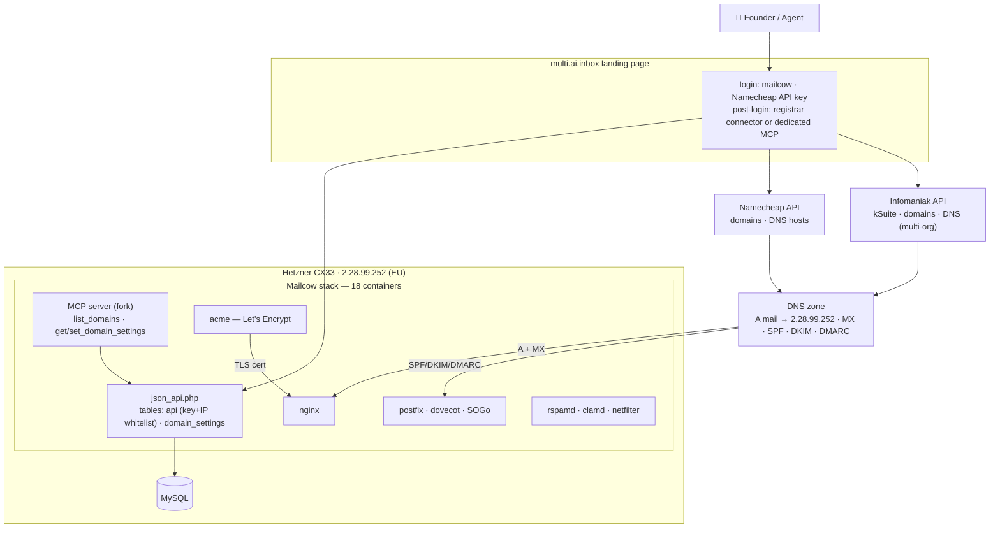
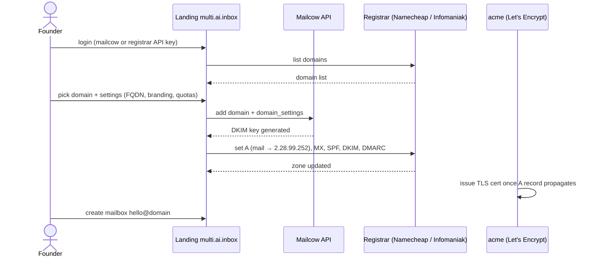
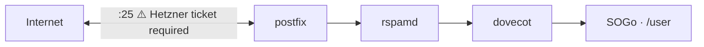

# mailcow: dockerized - 🐮 + 🐋 = 💕

## Want to support mailcow?

Please [consider a support contract with Servercow](https://www.servercow.de/mailcow?lang=en#support) to support further development. _We_ support _you_ while _you_ support _us_. :)

You can also [get a SAL](https://www.servercow.de/mailcow?lang=en#sal) which is a one-time payment with no liabilities or returning fees.

Or just spread the word: moo.

## Many thanks to our GitHub Sponsors ❤️
A big thank you to everyone supporting us on GitHub Sponsors—your contributions mean the world to us! Special thanks to the following amazing supporters:

### 100$/Month Sponsors
  
  
  

### 50$/Month Sponsors
  

## Info, documentation and support

Please see [the official documentation](https://docs.mailcow.email/) for installation and support instructions. 🐄

🐛 **If you found a critical security issue, please mail us to [info at servercow.de](mailto:info@servercow.de).**

## Cowmunity

[mailcow community](https://community.mailcow.email)

[Telegram mailcow channel](https://telegram.me/mailcow)

[Telegram mailcow Off-Topic channel](https://t.me/mailcowOfftopic)

[Official 𝕏 (Twitter) Account](https://twitter.com/mailcow_email)

---

# multi.ai.inbox — how the service works

This fork turns mailcow into **multi.ai.inbox**: an inbox-as-a-service layer for AI agents across multiple brands (5 domains, ~15 mailboxes), self-hosted on Hetzner (EU).

**What this fork adds on top of upstream mailcow:**

- **Landing page** (`landing/`) — public frontdoor with two login paths: mailcow credentials or **"Login with Namecheap"** (API-key connect; Namecheap has no OAuth for third-party apps)
- **Post-login connector choice** — *Login with Namecheap* (list domains, manage DNS) or *Use dedicated MCP* (the fork's native MCP server)
- **Per-domain Settings page** (`domain_settings` table) — mail FQDN, branding, PTR target, quotas + auto-generated DNS snippets per domain
- **Native MCP server** — tools `list_domains`, `get_domain_settings`, `set_domain_settings` on top of `json_api.php`, authenticated with the same `api` key table
- **Registrar connectors** — Namecheap (API key) and Infomaniak (OAuth v2, multiple organizations)

## Architecture

## Domain provisioning flow

## Mail flow

**Security model:** the Namecheap/Infomaniak keys live server-side (never in the repo or logs); DNS writes use single-record updates only (`update_dns_record`) — full-zone replaces (`setHosts`) would wipe SPF/DKIM/DMARC.

---

[mailcow community](https://community.mailcow.email)

## Misc

**Important**: mailcow makes use of various open-source software. Please assure you agree with their license before using mailcow.
Any part of mailcow itself is released under **GNU General Public License, Version 3**.

mailcow is a registered word mark of The Infrastructure Company GmbH, Parkstr. 42, 47877 Willich, Germany.

The project is managed and maintained by The Infrastructure Company GmbH.

Originated from @andryyy (André)
