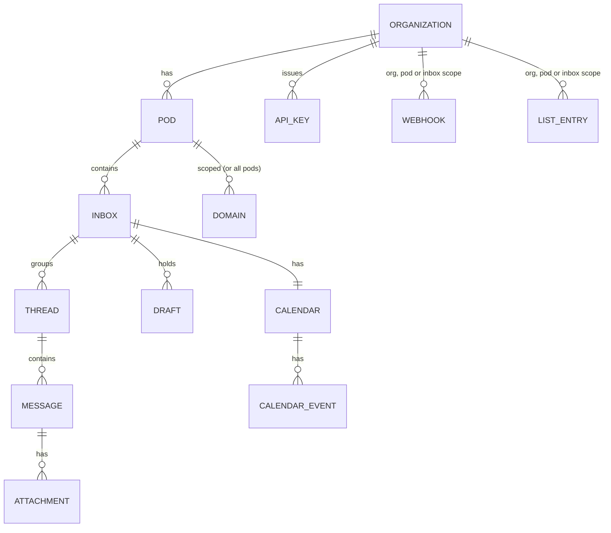

# 05 · Features and API specification

Part A is the reference API as documented publicly on `docs.agentmail.to` (28 pages read as `.md`). Part B is the multi.ai.inbox v0 contract we derive from it. Tags: **[observed]**, **[unverified]**, **[decision]**.

## Part A · Reference API [observed unless tagged]

### A.1 Basics

| Topic | Reference behavior |
|-------|--------------------|
| Base URLs | `https://api.agentmail.to/v0`, EU `https://api.agentmail.eu/v0`; pay per call hosts `x402.api.agentmail.to`, `mpp.api.agentmail.to` |
| Auth | `Authorization: Bearer am_...` (US keys `am_us_`); optional immutable `expires_at`; MCP accepts `x-api-key` or OAuth; IMAP/SMTP use inbox address + API key |
| Pagination | cursor: `limit`, `page_token` → `count`, `next_page_token`, array; newest first, `ascending=true` to flip; search `limit` max 100 |
| IDs | `inbox_id` = the email address; `message_id` = RFC Message-ID with angle brackets (URL encoded in paths); `thread_id`, `api_key_id`, `organization_id` = UUID; webhook `ep_...`; pod `pod_...` [unverified format] |
| Client ids | every create accepts `client_id` (1 to 256 chars `A-Za-z0-9-._~`) for idempotent creation |
| Region gaps | Calendar, Labs, Agent Armor, polling webhooks, AgentID are US only |

### A.2 Resource model



| Resource | Key fields | Notable rules |
|----------|-----------|---------------|
| Organization | `organization_id`, `inbox_limit`, `suspended_at`, `suspended_reason` | `GET /organizations` |
| Pod | `pod_id`, `client_id` | Default pod auto created, undeletable; delete only when empty (409 `cannot_delete`); inboxes cannot move between pods |
| Inbox | `pod_id`, `inbox_id`, `email`, `display_name`, `client_id`, `status` (`active`/`paused`), `metadata` (up to 256 keys), timestamps | create takes `username` (random if empty), `domain` (default shared); paused: sends 403 `inbox_paused`, inbound dropped; delete 202 with async cascade |
| Thread | `thread_id`, `inbox_id`, `labels[]`, `senders[]`, `recipients[]`, `subject`, `preview`, `last_message_id`, `message_count`, `size`, `attachments[]`, `messages[]` (on get) | org wide queries supported |
| Message | `message_id`, `thread_id`, `from`, `to/cc/bcc/reply_to[]`, `subject`, `text`, `html`, `extracted_text`, `extracted_html`, `preview`, `attachments[]`, `in_reply_to`, `references[]`, `headers`, `labels[]`, `authentication_results` (spf, dkim, dmarc, domains, arc_sealer), `agent_armor`, `calendar_event_id` | list returns metadata + preview only, no bodies |
| Draft | `draft_id`, recipients, `subject`, `text`, `html`, attachments, labels, `send_at`, `send_status` (`scheduled`/`sending`/`failed`), `in_reply_to` or `forward_of`, `reply_all` | kind fixed at create; `add_*`/`remove_*` patch ops; sending converts to Message and deletes draft |
| Attachment | `attachment_id`, `filename`, `content_type`, `size`, `content_disposition`, `content_id` | GET returns JSON with presigned `download_url`, `text_url`, `expires_at`; send accepts base64 `content` or `url` |
| Label | plain strings | system: `received`, `sent`, `spam`, `blocked`, `unauthenticated`, `trash`, `scheduled`, `opened`, `agent-armor-held`; trash is a label, DELETE is permanent |
| List entry | `entry` (address or domain), `reason` | matrix direction `send`/`receive`/`reply` × `allow`/`block`; scopes org, pod, inbox (most specific wins); replies checked only against reply lists; bounce, complaint and unsubscribe entries are automatic and read only |
| Domain | `domain_id`, `status` (`not_started`, `pending`, `invalid`, `failed`, `verifying`, `verified`), `feedback_enabled`, `subdomains_enabled`, `records[]` | addressed by name in paths |
| Webhook | `webhook_id`, `url`, `event_types[]` (required), `inbox_ids[]` + `pod_ids[]` (max 10), `enabled`, `secret`, write only `headers` | patch with `add_/remove_inbox_ids`, `add_/remove_pod_ids` |
| API key | `api_key_id`, `api_key` (shown once), `name`, `permissions` (boolean map), `expires_at`, `type` (`bearer`/`public_key`) | scope org, pod or inbox; no permissions object = all except `agent_armor_release`; effective = scope ∩ permissions; no escalation on child keys |
| Calendar / Event | one calendar per inbox (`timezone`); event `kind` single/series/instance, RRULE, attendees, `etag` | writes need `If-Match` (428 missing, 412 stale) |

Permission names: `inbox_{read,create,update,delete}`, `message_{read,reply,send,update,delete}`, `draft_{read,create,update,delete,send}`, `webhook_*`, `domain_*`, `list_entry_{read,create,delete}`, `api_key_*`, `pod_*`, `calendar_{read,update}`, `calendar_event_*`, `metrics_read`, `organization_read`, `agent_armor_release`, `label_{spam,blocked,unauthenticated,trash}_read`, `app_connect`, `app_share_owner`, `account_update`.

### A.3 Endpoints (all under `/v0`)

| Group | Endpoints |
|-------|-----------|
| Inboxes | `GET/POST /inboxes`, `GET /inboxes/search`, `GET/PATCH/DELETE /inboxes/{inbox_id}`, `POST /inboxes/{id}/authorize`, `GET /inboxes/{id}/events` |
| Messages | `GET /inboxes/{id}/messages` (filters `labels`, `before`, `after`, `from`, `to`, `subject`, `include_spam/blocked/unauthenticated/trash`), `GET .../messages/search?q=`, `POST .../messages/send`, `GET/PATCH/DELETE .../messages/{mid}`, reply, reply all, forward, batch get, batch update, raw (`download_url`), `GET .../messages/{mid}/attachments/{aid}`, `POST .../agent-armor/release`, `POST .../agent-armor/feedback` |
| Threads | per inbox and org wide: list, search, get, update, delete, get attachment |
| Drafts | per inbox CRUD + `POST .../drafts/{did}/send`; org wide list and get |
| Pods | `GET/POST /pods`, `GET/DELETE /pods/{pod_id}`, plus pod scoped inboxes, threads, drafts, domains, webhooks, lists, metrics, api keys, accounts |
| Domains | `GET/POST /domains`, `GET/PATCH/DELETE /domains/{domain}`, `POST /domains/{domain}/verify`, get zone file, get setup link |
| Webhooks | CRUD + get/update headers; polling webhooks list/get/create/delete; same at pod and inbox scope |
| Lists | `GET/POST /lists/{send|receive|reply}/{allow|block}`, `GET/DELETE .../{entry}`; also pod and inbox scope |
| Metrics | query events, query usage, query rates (org, pod, inbox scope) |
| API keys | CRUD, `?type=public_key` for AgentID keys; also pod and inbox scope |
| Agent | `POST /agent/sign-up` (no auth), `POST /agent/human`, `POST /agent/verify` |
| Organizations | `GET /organizations`, labs get and join; `GET /auth/me` (who am I) |
| Apps / Accounts | list, search, get, connect (Idempotency-Key), list accounts, update account |
| Calendar | `GET/PATCH /inboxes/{id}/calendar`, events CRUD, agenda, instances, respond |
| WebSocket | `client.websockets.connect()`; raw URL [unverified] |

### A.4 Events

Webhook event types (20): `message.received`, `message.received.spam`, `message.received.blocked`, `message.received.unauthenticated`, `message.sent`, `message.delivered`, `message.bounced`, `message.complained`, `message.rejected`, `message.opened`, `message.security.completed`, `message.security.review`, `message.security.override`, `domain.verified`, `calendar.event.{created,updated,deleted,responded,starting,ending}`.

* Envelope `{type:"event", event_type, event_id, ...}`; `message.received` carries full `message` and `thread`; bodies over 64 KiB replaced by `body_url` (presigned, 1 h).
* Spam, blocked and unauthenticated variants must be subscribed explicitly and need the matching `label_*_read` permission.
* Signing by Svix: `svix-id`, `svix-timestamp`, `svix-signature` (`v1,<sig>`), secret `whsec_...`, 5 min tolerance.
* Delivery: 2xx within 15 s; retries immediately, 5 s, 5 min, 30 min, 2 h, 5 h, 10 h, 10 h (8 attempts, about 27.5 h); endpoint auto disabled after 5 days of failure without notification; at least once, unordered; dedupe on `event_id`.
* WebSocket: `{type:"subscribe", inbox_ids?, pod_ids?, event_types?}` → `{type:"subscribed"}`; frames use underscored names (`message_received`); calendar events opt in.
* Open tracking: one pixel per message, only with `track_opens` on custom domains.

### A.5 Limits, idempotency and errors

* Plan limits: Free 100/day, 3 inboxes; Developer 1,000/day, 10,000/mo; Startup 15,000/day, 150,000/mo. New free accounts may mail at most 3, 5, 10 new recipients in the first hour, day, week.
* API rate limits per org, unpublished; 429 with `Retry-After` (usually 1 s); SDKs auto retry.
* Per message: max 50 recipients; inline request 6 MB (413); URL attachments about 30 MB total; SMTP 10 MB per message.
* Idempotency: `client_id` on create (repeat returns 200 + original); `Idempotency-Key` header on send, reply, forward, draft send; org scoped, 24 h; same key with different body → 409 `conflict`.
* Error envelope `{name, code, message, fix?, docs, errors?[]}`; codes include `missing_authorization`, `invalid_token_type`, `unknown_api_key`, `api_key_expired`, `missing_permission`, `permission_escalation`, `account_suspended`, `inbox_paused`, `message_rejected`, `validation_error`, `not_found` (also hides out of scope), `already_exists`, `limit_exceeded`, `domain_not_verified`, `conflict`, `cannot_delete`, `rate_limit_exceeded`, `service_unavailable`, `internal_error`.

### A.6 Domains and deliverability

* Flow: `POST /domains` → `records[]`, `pending` → auto verification (or `POST .../verify`) → `domain.verified`.
* Records: DKIM TXT at `selector._domainkey`; SPF on MAIL FROM subdomain `mail` with `include:amazonses.com`; DMARC `p=reject` with `rua` required; MX `@` to `inbound-smtp.<region>.amazonaws.com`; MX `mail` for bounces; wildcard MX when `subdomains_enabled`.
* **Underlying provider is Amazon SES** (us-east-1, eu-central-1 for EU).
* No automated warm up (advice only: 10, 20, 40 per inbox per day); automatic permanent suppression on bounce, reject, complaint; suspensions for high rates.
* Inbound DMARC fail under quarantine or reject is dropped unless a trusted ARC seal vouches; weak auth delivered with `unauthenticated` label.

### A.7 Agent features

* **Agent self sign up:** `POST /agent/sign-up {username, human_email?}` (no auth) → `{organization_id, inbox_id, api_key}`; human gets a 6 digit OTP; `POST /agent/verify {otp_code}`. Before verification: 1 inbox, 10 emails/day, only to the human, no keys, lists, pods or apps.
* **Agent Armor:** `agent_armor{status: pending|complete|unavailable, verdict: clear|review, reason, model}`; monitor mode (default, no delay) or hold mode (delays `message.received`, labels `agent-armor-held`); release needs `agent_armor_release`; feedback categories `correct_review`, `incorrect_review`, `missed_threat`, `legitimate_agent_instruction`, `spam_or_phishing`; scan deadline 15 min, payload cap about 256 KB.
* **Reply extraction:** strips quoted history and boilerplate, keeps signatures; open source as npm `agentextract` (MIT). Attachment text for PDF, DOC/DOCX, XLSX, text formats, up to 10 MB and 250k chars, exposed as `text_url`.
* **IMAP/SMTP:** `imap.agentmail.to:993` (IDLE), `smtp.agentmail.to:465/587`; From must equal the inbox.
* **MCP:** `https://mcp.agentmail.to/mcp`, 47 tools (inboxes, threads, messages, drafts, attachments, calendar, lists, agent, apps, labs) + org selection under OAuth; MCP Events push of `message.received` metadata.
* **SDKs:** Python (`agentmail`, sync + async), TypeScript (`agentmail`), CLI (`agentmail-cli`); other languages only as raw HTTP snippets.

## Part B · multi.ai.inbox v0 contract [decision]

### B.1 Compatibility principle
Same resource names, paths, field names, pagination, error envelope and event names as Part A, so an agent written for the reference works by changing base URL and key. We differ only where noted.

| Area | Reference | multi.ai.inbox |
|------|-----------|----------------|
| Base URL | `api.agentmail.to/v0` | `api.<domain>.eu/v0`, EU only at launch |
| Key prefix | `am_` | `mai_live_` / `mai_test_` (test keys never deliver externally) |
| Mail provider | Amazon SES | own Postfix + rspamd (mailcow), SES EU as fallback relay |
| Webhook signing | Svix headers | Standard Webhooks spec: emit both `webhook-*` and `svix-*` headers with the same signature, so Svix verifiers work |
| Webhook auto disable | silent | email the owner on disable and allow replay of missed events for 7 days |
| Warm up | advice only | automatic per domain ramp (Team plan) |
| Armor | US only, Labs | EU, heuristics on all plans, classifier on Team |
| Calendar | US only | later phase, EU |

### B.2 Scope by phase

| Phase | Endpoints |
|-------|-----------|
| P0 MVP | `auth/me`, `api-keys` (org scope, all permissions), `inboxes` CRUD, `messages` list/get/raw/attachments/send/reply/reply-all/forward/update (labels), `threads` list/get/update/delete (inbox + org), `webhooks` CRUD, events `message.received`, `message.sent`, `message.delivered`, `message.bounced`, `message.complained`, `message.rejected` |
| P1 | `domains` (+ zone file, verify, registrar connect `POST /domains/{d}/connect {provider}` new), `drafts` + scheduled send, search, WebSocket, polling webhooks, `agent/sign-up|verify|human`, reply and attachment extraction, `domain.verified`, `received.spam|unauthenticated` variants |
| P2 | `pods` + pod scope everywhere, scoped permissions, `lists`, `metrics`, Armor fields + `message.security.*`, batch get/update, IMAP/SMTP |
| P3 | calendar, apps/accounts, organizations labs |

### B.3 Example: send message

```http
POST /v0/inboxes/sales%40acme.ai/messages/send
Authorization: Bearer mai_live_xxx
Idempotency-Key: quote-42
Content-Type: application/json

{
  "to": ["vendor@example.com"],
  "subject": "Quote request",
  "text": "Hi, could you send a quote for 40 units?",
  "html": "<p>Hi, could you send a quote for 40 units?</p>",
  "labels": ["procurement"],
  "attachments": [{"filename": "spec.pdf", "content_type": "application/pdf", "content": "<base64>"}]
}
```
```json
{ "message_id": "<01J...@acme.ai>", "thread_id": "8b1f0c2e-..." }
```

### B.4 Validation
OpenAPI 3.1 in `packages/openapi` is the single source. Go handlers validate with generated types plus explicit checks; the web BFF and SDK use Zod schemas generated from the same file, so client, server and MCP tool inputs share one definition (founder rule: Zod on every input).
