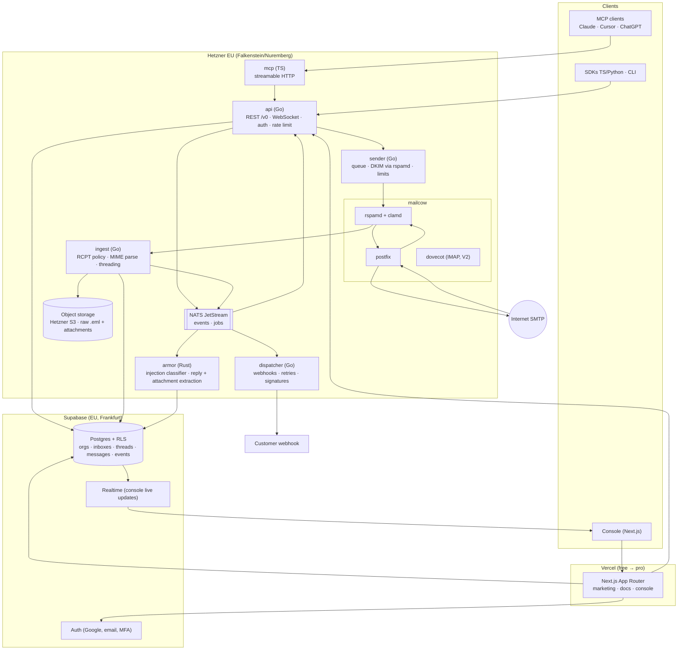

# 06 · Architecture, infrastructure and scalability

AgentMail does not publish its backend, but its custom domain DNS records show that mail runs on Amazon SES (inbound MX `inbound-smtp.<region>.amazonaws.com`, SPF `include:amazonses.com`) and webhooks are signed by Svix [observed]. Other public facts that constrain the design [observed]: peak 100K API requests per minute, 1B+ emails processed, 10M+ inboxes, webhooks plus WebSockets plus polling, IMAP and SMTP access, EU region and BYO cloud for Enterprise, optimized shared IPs and dedicated IPs, Svix style polling webhooks. Everything below is our [decision] for multi.ai.inbox, built on the mailcow stack already running in this repo.

> Update: mailcow is the **transition** runtime. The target removes all PHP and replaces Postfix and Dovecot with Go services step by step; see [10 · ADR native platform](10-native-platform.md). The data model, event flow and scaling rules below stay valid.

## 1. Key design insight: an inbox is a row, not a mailbox

10M inboxes cannot be 10M Dovecot mailboxes with quotas and maildirs. The reference's economics ($2 per extra inbox, 3 free inboxes per signup) only work if an inbox is a **database row** and mail routing is **catch all**.

* Postfix accepts mail for every verified domain (shared domain + customer domains) via a catch all transport.
* Every accepted message goes to one ingest service that looks up the recipient in Postgres. Unknown recipient: reject at RCPT time (no backscatter) using a Postfix policy or `tcp_table` lookup served by the ingest service.
* Raw MIME goes to object storage once; parsed metadata goes to Postgres. Messages are immutable; labels and state are mutable.
* Dovecot stays only for the optional IMAP feature, reading from the same store through a custom backend later (V2). Mailcow mailboxes remain for the founder's own human mail.

## 2. Target architecture (V1)



### Service responsibilities

| Service | Lang | Why this language | Responsibilities |
|---------|------|-------------------|------------------|
| `web` | TypeScript (Next.js) | founder stack | marketing, docs, console, BFF; never on the mail hot path |
| `api` | Go | connectivity rule, high concurrency, cheap memory | REST, WebSocket hub, API key auth, plan limits, idempotency, OpenAPI source of truth |
| `ingest` | Go | SMTP adjacent, streaming MIME | RCPT validation, parse MIME, thread assignment, store raw, emit `message.received` |
| `sender` | Go | SMTP client, queues | render MIME, threading headers, footer, rate limit per org and per domain, submit to Postfix (or relay), track DSNs |
| `dispatcher` | Go | outbound HTTP at scale | webhook fan out, HMAC signatures, exponential retry, dead letter, replay |
| `armor` | Rust | AI workloads rule, ONNX runtime, fast text processing | prompt injection classification, reply extraction, PDF/DOCX/XLSX text extraction |
| `mcp` | TypeScript | MCP SDK maturity; repo already has an MCP server | tools mapping to REST |

### Inbound path (target p95 under 3 s to webhook)
1. Postfix `RCPT TO` → policy check against `ingest` (Postgres lookup cached in memory, 60 s TTL). Unknown recipient or blocked sender: 550.
2. Rspamd scores spam; clamd rejects viruses at DATA.
3. Postfix delivers via LMTP to `ingest` (single transport for all agent domains).
4. `ingest` streams raw to S3 (`raw/{org}/{yyyy}/{mm}/{message_id}.eml`), parses headers and bodies, resolves thread, writes `messages` row in one transaction with an **outbox** row.
5. Outbox relay publishes `message.received` to NATS; `dispatcher` and the WebSocket hub consume; `armor` runs asynchronously and emits `message.security.completed` (and `review` if flagged).

### Outbound path
1. `POST /v0/inboxes/{id}/messages/send` → validation (Zod equivalent in Go: generated from the same OpenAPI), permission and list checks, limits (token buckets in Postgres or Redis: month, day, 5 min).
2. Idempotency key stored 24 h; duplicate returns the first response.
3. Job to NATS `send.*`; `sender` builds MIME, signs DKIM through rspamd (per domain selector), submits to Postfix.
4. Postfix hands off directly (after Hetzner opens port 25) or through an EU relay (Amazon SES eu-central-1 or Scaleway TEM) until then.
5. DSN and feedback loop parsing produce `message.delivered`, `message.bounced`, `message.complained`; suppression list updated.

## 3. Data model (Postgres, RLS on every table)

```sql
-- tenancy
organizations(id uuid pk, name, plan, region, status, created_at)
memberships(org_id fk, user_id fk auth.users, role enum(owner,admin,member))
pods(id, org_id fk, name, client_id unique(org_id, client_id))
api_keys(id, org_id, pod_id null, prefix, hash, name, scopes jsonb, inbox_ids uuid[] null, last_used_at, revoked_at)

-- addressing
domains(id, org_id, pod_id null, name unique, status enum(pending,verifying,verified,failed),
        dkim_selector, dkim_private_key_ref, spf_ok, dkim_ok, dmarc_ok, mx_ok, verified_at)
inboxes(id uuid, org_id, pod_id null, address citext unique, domain_id, display_name,
        client_id, deleted_at, created_at)

-- mail
threads(id, org_id, inbox_id, subject_norm, last_message_at, message_count, labels text[], preview)
messages(id, org_id, inbox_id, thread_id, direction enum(in,out), rfc_message_id, in_reply_to, refs text[],
         from_addr, to_addrs text[], cc_addrs text[], subject, text, html, extracted_text, extracted_html,
         labels text[], size_bytes, raw_key, status enum(queued,sent,delivered,bounced,rejected,received),
         security_verdict enum(safe,review,blocked) null, created_at)
attachments(id, message_id, filename, content_type, size, storage_key, extracted_text, sha256)
drafts(id, org_id, inbox_id, thread_id null, payload jsonb, send_at null, status)
list_entries(id, org_id, pod_id null, inbox_id null, direction enum(send,receive,reply),
             kind enum(allow,block), value citext)
suppressions(org_id, address citext, reason, created_at)

-- events
events(id bigserial, org_id, pod_id, inbox_id, type, payload jsonb, created_at)    -- partitioned by month
outbox(id bigserial, event_id, published_at null)
webhooks(id, org_id, pod_id null, url, secret_ref, event_types text[], inbox_ids uuid[] null, kind enum(push,poll), enabled)
webhook_deliveries(id, webhook_id, event_id, attempt, status_code, next_retry_at, response_ms)

-- billing and usage
usage_daily(org_id, day, sent, received, storage_bytes, inboxes)
subscriptions(org_id, stripe_customer_id, stripe_subscription_id, plan, addons jsonb, period_end)
idempotency_keys(org_id, key, request_hash, response jsonb, expires_at)
```

RLS pattern: console users access rows where `org_id in (select org_id from memberships where user_id = auth.uid())`. The Go API uses a service role connection but sets `request.jwt.claims` per request (`set_config`) so the same RLS policies apply to API key requests; pod scoped keys add `pod_id = current_setting('app.pod_id')::uuid`. Defense in depth: queries also filter explicitly.

Indexes that matter: `messages(inbox_id, created_at desc)`, `threads(inbox_id, last_message_at desc)`, `messages(rfc_message_id)`, GIN on `labels`, `tsvector` on subject + extracted_text for search, `events(org_id, id)` for cursors.

## 4. Scalability path

| Stage | Load | Infra | Monthly cost |
|-------|------|-------|--------------|
| S0 MVP | < 100 orgs, < 50K emails/mo | Existing Hetzner CX33 (mailcow + Go services in Docker), Supabase free, Vercel hobby, Hetzner Object Storage, Cloudflare DNS free | about €10 |
| S1 first revenue | < 1K orgs, < 1M emails/mo | Split: CX33 for mailcow, CPX31 for Go services + NATS; Supabase Pro; Vercel Pro | about €80 |
| S2 growth | < 10K orgs, < 20M emails/mo | 2 MX nodes (inbound HA, MX priority), 3 node NATS, API behind Hetzner LB, Postgres on Supabase with read replica, events table partitioned and moved to ClickHouse for metrics | €600 to €1,200 |
| S3 scale | 100K req/min like the reference | Kubernetes (k3s on Hetzner or managed), sharding Postgres by `org_id` (Citus) or splitting `messages` into a dedicated store, multiple outbound IP pools with warm up, dedicated IPs as paid add on | €5K+ |

Rules that keep scaling cheap:
* Mail hot path never touches Next.js or Vercel.
* Everything async goes through the outbox and NATS: retries, armor, extraction, webhooks.
* Large blobs never in Postgres; only S3 keys.
* Per org rate limits protect shared IP reputation and the database.
* Stateless Go services: horizontal scale behind a load balancer; WebSocket hub uses NATS subjects so any node can serve any subscription.

## 5. Reliability and operations

* SLOs: API 99.9%, inbound acceptance 99.95% (two MX hosts from S2), webhook first attempt p95 under 3 s.
* Backups: Supabase PITR (Pro), S3 versioning, nightly mailcow backup script (already in repo `helper-scripts`).
* Observability: OpenTelemetry from Go and Rust to Grafana Cloud free tier; Sentry for web and Go; status page with Upptime (GitHub Pages, free).
* Deploy: GitHub Actions builds images to GHCR; Hetzner hosts pull via Watchtower or a simple `docker compose pull && up -d` job; Vercel for web.
* Runbooks: IP blocklisted, DKIM key rotation, queue backlog, Supabase outage (API returns 503 and Postfix defers with 4xx, mail is never lost).

## 6. Regions and deployment options

* Default region: EU (Hetzner Germany + Supabase Frankfurt). This is our differentiator; the reference offers EU only on Enterprise [observed].
* US region (later): same compose stack on Hetzner Ashburn plus Supabase us-east.
* Self host: the open core compose file (mailcow + our services) for enterprise and hobbyists; BYO cloud equivalent of the reference.
