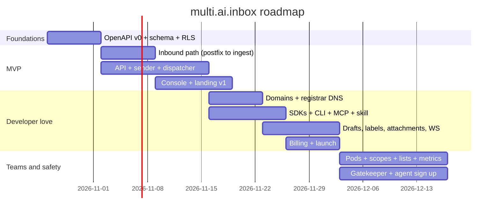

# 09 · Execution plan (CPO + CTO)

Team: one technical founder plus coding agents. Principle: ship the smallest thing that receives and sends an email for an agent, then widen. Dates assume a start on Monday 2026-10-26.

## 1. Strategy in one paragraph

The reference product proved the category (10M+ inboxes, 1B+ emails). We do not win by out featuring it. We win a segment: **EU builders and regulated teams** who want EU residency on every plan, one click custom domains through their registrar, and a self host escape hatch. We keep API compatibility (same resources and verbs) so trying us costs a base URL change, and we sell to agents directly through MCP, a skill and `llms.txt`.

## 2. Phases

### Phase 0 · Foundations (week 1)
* Decide the open points in section 5 (domain name, relay, licence).
* Monorepo layout next to mailcow: `services/api`, `services/ingest`, `services/sender`, `services/dispatcher` (Go), `services/armor` (Rust), `apps/web` (Next.js, `src/` per founder convention), `packages/openapi`.
* Write `openapi.yaml` v0 for: orgs (me), api keys, inboxes, messages (send, list, get, raw), threads, webhooks. This is the contract every other piece is generated from.
* Supabase project (EU), first migration with RLS for all tables in [06](06-architecture-infrastructure.md#3-data-model-postgres-rls-on-every-table).
* `.claude/context/TODO.md`, `.clauderules/stack-rules.md` updated with the approved libraries list.
**Exit:** OpenAPI reviewed, migration applied, CI green (lint, typecheck, `go test`, `cargo test`).

### Phase 1 · MVP "receive and reply" (weeks 2 to 4)
* Postfix catch all transport for the shared domain → LMTP into `ingest`; RCPT policy lookup.
* `ingest`: MIME parse, S3 raw store, threading, `message.received` via outbox.
* `api`: API key auth, inboxes CRUD, send / reply / forward, threads and messages read, idempotency, plan limits.
* `sender`: DKIM via rspamd, submission through EU relay until Hetzner port 25 is open.
* `dispatcher`: signed webhooks, retries, delivery log.
* Console (Next.js + Supabase Auth): sign up, API key, inbox list, thread reader, webhook endpoints and log, quickstart.
* Landing page v1 (home, pricing, security, docs quickstart, `llms.txt`).
**Exit (activation test):** a stranger signs up, creates an inbox with cURL, receives a Gmail message and gets a webhook in under 3 s, replies and the reply threads in Gmail. Time to first email under 2 minutes.

### Phase 2 · Developer love (weeks 5 to 7)
* Custom domains with zone file + verification job; Namecheap, Infomaniak and Cloudflare one click DNS.
* TypeScript and Python SDKs, Go CLI, hosted MCP server (extend the existing fork MCP), Claude Code skill repo.
* Drafts + scheduled send + approval queue; labels; attachments upload and download.
* WebSocket events and polling webhooks.
* Reply extraction and attachment text extraction (Rust).
* Stripe billing: plans, add ons, usage page, limit alerts.
* Public launch: Show HN, Product Hunt, r/LocalLLaMA, Discord, EU startup communities.
**Exit:** 50 orgs, 5 paying, MCP listed in at least two MCP directories.

### Phase 3 · Teams and safety (weeks 8 to 11)
* Pods, scoped API keys, allow and block lists, metrics endpoints.
* Gatekeeper (Armor equivalent): heuristics first, then classifier.
* Agent self sign up + claim flow.
* Suppression list, warm up schedules, deliverability dashboard.
* Org members and roles, MFA.
**Exit:** 10 paying customers, complaint rate under 0.1%, first platform customer using pods.

### Phase 4 · Expansion (week 12 onward, demand driven)
IMAP / SMTP access, calendar with iMIP, dedicated IPs, self host package, US region, SOC 2 Type I, AgentID style app sign in.

## 3. Milestone timeline

## 4. KPIs per phase

| Phase | Leading indicator | Target |
|-------|-------------------|--------|
| 1 | Time to first inbound email | p50 under 2 min |
| 1 | Webhook latency | p95 under 3 s |
| 2 | Signup to first send | 50% within 24 h |
| 2 | Paying orgs | 5 |
| 3 | Weekly active inboxes | 500 |
| 3 | Complaint rate | under 0.1% |

## 5. Decisions to take (founder)

| # | Decision | Options | Recommendation |
|---|----------|---------|----------------|
| D1 | Shared free domain | buy a short neutral domain (`.eu`, `.to`, `.email`) | short `.eu` domain, reinforces positioning |
| D2 | Outbound before port 25 opens | Amazon SES eu-central-1, Scaleway TEM, Brevo | SES EU: cheapest at volume ($0.10 per 1,000), good reputation; keep Postfix direct as goal |
| D3 | Event bus | NATS JetStream, Redis Streams, Postgres only (LISTEN/NOTIFY + outbox) | Postgres only for MVP (zero new infra), NATS at S1 |
| D4 | Console auth | Supabase Auth, Clerk | Supabase Auth (free, same DB as RLS) |
| D5 | Docs | Fumadocs in Next app, Mintlify free | Fumadocs |
| D6 | Licence of new code | AGPL 3.0 open core, proprietary | AGPL for the self host core, proprietary for Gatekeeper model and billing |
| D7 | New libraries outside the current stack | oapi-codegen, NATS, ort (ONNX), openapi-zod-client | approve as a batch in `.clauderules/stack-rules.md` before Phase 1 |
| D8 to D10 | Native platform (no PHP): Go mail libraries, Postgres location, founder's human mailboxes | see [10 · ADR](10-native-platform.md#6-decisions) | approve with the ADR; phases map to migration steps M0 to M8 |

## 6. Risks

| Risk | Likelihood | Impact | Mitigation |
|------|------------|--------|------------|
| Shared IP reputation burned by one abuser | high | high | strict free caps, circuit breakers, separate IP pools for free and paid |
| Hetzner keeps port 25 closed | medium | medium | relay through SES EU; move outbound to a provider with port 25 |
| Reference product adds EU region to all plans | medium | high | differentiate also on self host, registrar one click and price in EUR |
| Solo founder bandwidth | high | high | generated SDKs and server stubs from OpenAPI, coding agents per domain, ruthless phase scope |
| Prompt injection incident at a customer | medium | high | Gatekeeper, verdict in every payload, clear shared responsibility docs |
| Legal (copying claims) | low | medium | own brand, own copy, API shape only; see pack README |

## 7. What to do this week

1. Approve D1 to D7.
2. Merge this documentation pack.
3. Draft `packages/openapi/openapi.yaml` v0 from [05](05-features-and-api.md).
4. Create the Supabase EU project and the first RLS migration.
5. Open the Hetzner ticket for port 25 if not done.

## 8. Decisions taken (2026-10-22)

| # | Decision | Choice |
|---|----------|--------|
| D1 | Shared domain | Local only for now (`agents.localhost`); brand domain bought after branding. Staging API uses `api.2-28-99-252.sslip.io` for real TLS |
| D2 | Outbound relay | Brevo (EU) until outbound port 25 is confirmed; no AWS |
| D3 | Event bus | Postgres outbox polled by workers |
| D6 | Licence | Proprietary, all rights reserved |
| D8 | Libraries | Approved, see `.clauderules/stack-rules.md` |
| D9 | Postgres | Self hosted on Hetzner (k3s StatefulSet, nightly backups to Object Storage) |
| D10 | Human mailboxes | None to migrate: no customers, staging only; testers created by `mai admin seed` |
| Deploy | Infrastructure | Existing CX33 reinstalled with k3s + Flux GitOps (`deploy/hetzner/bootstrap.sh`) |
