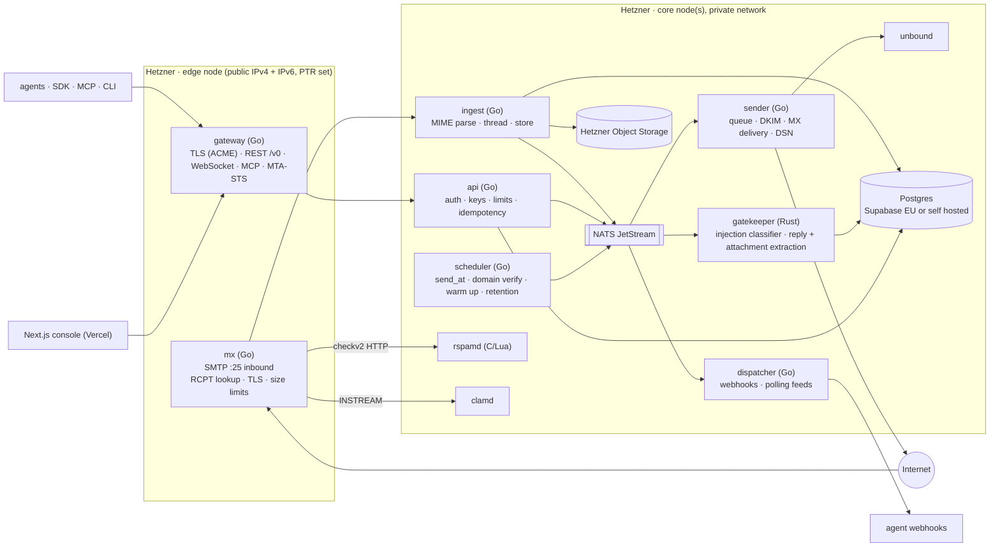

# 10 · ADR: remove mailcow PHP, build an agent native mail platform in Go and Rust

Status: proposed · Date: 2026-10-22 · Deciders: founder (CPO + CTO)
Context: production runs on Hetzner (CX33, EU) with the mailcow stack from this repo. The goal is to remove every PHP component and own a native platform in Go (connectivity) and Rust (AI and parsing), designed for agents first and humans second.

## 1. What PHP does today in this repo (inventory)

PHP is not just the admin UI. `php-fpm-mailcow` is the glue between the other containers. Removing it means replacing every one of these contracts.

| # | PHP piece | Called by | What it does | Native replacement |
|---|-----------|-----------|--------------|--------------------|
| 1 | `data/web/*.php`, `admin/`, `domainadmin/`, `user.php`, Twig templates | browser via nginx | admin, domain admin and user UI | Next.js console (doc 03), no PHP |
| 2 | `json_api.php` + `inc/functions.*.inc.php` (about 25K lines, 73 files excluding vendor) | admins, scripts, the fork's MCP | CRUD on domains, mailboxes, aliases, DKIM, quarantine, rate limits, TLS policy, transports | Go `api` service, `/v0` agent API (doc 05) plus `/admin` internal API |
| 3 | `inc/init_db.inc.php` | php-fpm on boot | creates and migrates the MySQL schema | SQL migrations (Postgres) run by a Go `migrate` job |
| 4 | `data/conf/dovecot/auth/mailcowauth.php` | Dovecot Lua passdb over `https://nginx:9082` | IMAP/POP/SMTP auth, app passwords, rate limit | Go `authd` HTTP endpoint (same JSON contract) during migration, then Go IMAP/SMTP submission with API key auth |
| 5 | `sogo-auth.php` (nginx `auth_request`) | nginx for SOGo | SSO into webmail | removed with SOGo (no human webmail) |
| 6 | `data/conf/rspamd/dynmaps/settings.php`, `aliasexp.php`, `bcc.php`, `footer.php` | Rspamd HTTP maps | per domain spam settings, alias expansion, BCC maps, domain footer | Go `policyd` serving the same maps from Postgres (footer moves into the Go sender) |
| 7 | `data/conf/rspamd/meta_exporter/pipe.php`, `pipe_rl.php`, `pushover.php` | Rspamd metadata exporter | write quarantine items, rate limit hits, push notifications | Go ingest receives verdicts directly; quarantine = `spam` / `blocked` labels on messages |
| 8 | `qhandler.php`, `quarantine.php` | users via links | release or delete quarantined mail | `/v0` message label update + console review queue |
| 9 | `mta-sts.php`, `autoconfig.php`, `autodiscover*.php`, `mobileconfig.php` | mail clients, remote MTAs | MTA-STS policy, client autoconfiguration | Go `edge` HTTP handlers (static per domain, generated) |
| 10 | `crons/keycloak-sync.php`, `ldap-sync.php` (ofelia) | ofelia scheduler | identity sync | dropped (no human directory sync); enterprise SSO later via OIDC in console |
| 11 | `whitelist_forwardinghosts.sh` → PHP | Postfix | forwarding host allowlist | Go `policyd` |
| 12 | `inc/functions.docker.inc.php` → `dockerapi` | UI | restart containers, read logs | removed; ops through compose and CI |

Other mailcow containers that become unnecessary for an agent platform: `sogo` (webmail), `memcached` (SOGo), `php-fpm`, `mysql` (moved to Postgres), `ofelia` (replaced by a Go scheduler), `dockerapi`, `watchdog` (replaced by health checks + alerts), `olefy` (Office macro scan, folded into the attachment pipeline). Kept because they are not PHP and are best in class: `rspamd` (C + Lua), `clamd` (C), `unbound` (DNSSEC resolver for DANE and DNSBL). `postfix` and `dovecot` are kept **only during the transition** (section 4).

Licence note: mailcow is GPL 3.0. New services written from scratch in separate processes are not derivative works of mailcow; we can license them as we choose (D6 in doc 09). Keep the old fork code and the new services in separate directories with separate licence files.

## 2. Target: agent native platform

"Agent native" means the primary user is a program, not a person. Five properties, each learned from the reference product or from REA:

1. **Inbox is a row, mail is an event.** No mailbox per inbox, no maildir. Raw MIME in object storage, parsed messages in Postgres, every state change is an event (outbox → NATS → webhooks, WebSocket, MCP). From the reference [observed]: 10M+ inboxes only work this way.
2. **One capability, three surfaces.** Every operation exists in REST, MCP and CLI with the same schema, generated from one OpenAPI file. REA's lesson: the MCP server, the CLI and the skill expose the same tools, and setup registers the server with the agent client in one command (`npx ... setup`). We ship `mai setup` that registers our MCP server in Claude Code, Cursor and Codex.
3. **Evidence with every result.** REA returns evidence and limitations with each conclusion. Our equivalent: each message carries `authentication_results` (SPF, DKIM, DMARC, ARC), the Gatekeeper verdict with reasons, and provenance of extracted text, so an agent can decide whether to trust an email before acting.
4. **Agents can self serve, humans hold the leash.** Agent self sign up, scoped keys, allow and block lists, drafts with approval, per agent send budgets, audit log. Policy is enforced in the platform, not trusted to the prompt.
5. **Docs for machines.** `llms.txt`, `.md` per page, compact tool schemas by default (REA ships compact MCP input schemas to save context, full schemas on request); we do the same for our MCP tools.

### 2.1 Services

| Service | Language | Key libraries (need approval, D8) | Replaces |
|---------|----------|------------------------------------|----------|
| `mx` | Go | `emersion/go-smtp`, `emersion/go-msgauth` (SPF, DKIM, DMARC verify) | Postfix inbound |
| `ingest` | Go | `emersion/go-message` or `jhillyerd/enmime` for MIME | rspamd meta exporter PHP, Dovecot delivery |
| `sender` | Go | `go-msgauth` DKIM signing, own queue on Postgres + NATS, MTA-STS and DANE checks via `unbound` | Postfix outbound |
| `api`, `gateway` | Go | `jackc/pgx`, `oapi-codegen`, `nats.go`, `golang.org/x/crypto/acme/autocert`, official `modelcontextprotocol/go-sdk` | `json_api.php`, PHP UI, nginx, acme container |
| `dispatcher`, `scheduler` | Go | standard library HTTP, NATS | ofelia, PHP crons, watchdog |
| `gatekeeper` | Rust | `mail-parser` (MIT/Apache), `ort` (ONNX runtime), PDF/DOCX text crates | olefy, nothing equivalent in PHP |
| `imap` (later) | Go | `emersion/go-imap` v2 with a Postgres + S3 backend | Dovecot |
| `console` | TypeScript | Next.js, Supabase Auth, Zod, shadcn/ui | PHP admin UI |

Considered and rejected: **Stalwart** (Rust all in one mail server, JMAP + IMAP + SMTP on Postgres/S3). Technically excellent and the fastest way off mailcow, but AGPL 3.0 for the open edition and its data model is mailbox centric, not "inbox as a row". Keep it as plan B if building the outbound MTA in Go proves too slow.

### 2.2 Why Go for the MTA path is realistic
* Inbound is the easy half: accept, check, store. `go-smtp` handles the protocol; rspamd and clamd do the hard filtering over their network APIs.
* Outbound is the hard half (queueing, retries per MX, TLS policy, backoff on 4xx, DSN generation, IP warm up). Mitigation: phase it. Keep Postfix as the outbound relay first (Go `sender` submits to Postfix on localhost), then replace with direct delivery once volume and reputation data justify it. Amazon SES EU stays as a fallback relay (the reference product runs entirely on SES [observed]).

## 3. Hetzner deployment

| Stage | Topology | Monthly |
|-------|----------|---------|
| Now | CX33 runs mailcow (18 containers) | about €6 |
| Transition | Same CX33: new Go services next to mailcow in one compose project; Hetzner Object Storage bucket; Supabase EU free | about €11 |
| Native v1 | `edge` CX22 (mx + gateway, public IP with PTR, firewall 25/443 only) + `core` CX32 (api, ingest, sender, dispatcher, scheduler, gatekeeper, rspamd, clamd, unbound, NATS) on a private network; Postgres on Supabase Pro or self hosted on the core node | €25 to €50 |
| Scale | 2 edge nodes with separate IPs as MX 10 and MX 20, Hetzner Load Balancer for HTTPS, 3 node NATS, dedicated outbound IP pools (free vs paid tiers), Postgres primary + replica (dedicated AX server) | €300+ |

Hetzner specifics to automate in Go (Hetzner Cloud API): reverse DNS (PTR) per IP matching the HELO name, firewall rules, floating IPs for MX failover, snapshots. Port 25 outbound requires a Hetzner support request (already noted in the repo README); until approved the `sender` relays through SES EU on port 587.

Deploy: GitHub Actions builds static Go binaries and a Rust binary into distroless images on GHCR; hosts run `docker compose pull && up -d` from a CI job over SSH; config from environment, secrets in Hetzner hosts' env files (never in the repo). Zero downtime for `mx` with SMTP graceful shutdown (stop accepting, drain sessions, exit) and MX priority failover.

## 4. Migration plan (strangler, no big bang)

Every step is reversible and keeps mail flowing.

| Step | Change | Removes | Risk control |
|------|--------|---------|--------------|
| M0 | Freeze PHP features; add Postgres schema (doc 06) next to MySQL | nothing | read only sync job MySQL → Postgres for existing domains and mailboxes |
| M1 | Go `api` live for agents (`/v0`), console on Next.js; agent domains created only in Postgres | new work stops touching PHP | old domains still served by mailcow |
| M2 | Postfix transport for agent domains: `lmtp:inet:ingest:24` (catch all), RCPT lookup via `tcp_table`/`socketmap` served by Go `policyd` | Dovecot delivery for agent domains | per domain switch; rollback = remove transport map entry |
| M3 | Go `policyd` serves rspamd dynmaps and Dovecot auth contract (`authd`) with the same JSON; point Lua auth and rspamd maps at Go | PHP items 4, 6, 7, 11 | contract tests replay recorded PHP responses against Go |
| M4 | MTA-STS, autoconfig in Go gateway; ACME in Go; nginx removed | PHP item 9, `nginx`, `acme` | check with `mta-sts` validators |
| M5 | Remove `php-fpm`, `sogo`, `memcached`, `ofelia`, `dockerapi`, `watchdog`, `olefy`; migrate remaining human mailboxes (founder) to an external provider or keep Dovecot only for them | PHP entirely | backup first, keep MySQL dump 90 days |
| M6 | Go `mx` takes port 25 directly (Postfix inbound retired); rspamd + clamd called over HTTP/TCP | Postfix inbound | run Go `mx` as MX 20 first, then promote |
| M7 | Go `sender` delivers directly (Postfix outbound retired) after port 25 approval and warm up | Postfix | traffic split by org, SES fallback on persistent 4xx |
| M8 | Optional Go IMAP backed by Postgres + S3 if customers ask | Dovecot | feature flag per org |

After M5 there is no PHP left. After M7 the only third party daemons are rspamd, clamd, unbound and NATS.

## 5. What changes in the other docs
* Doc 06: mailcow is the **transition** runtime, not the target. The target is this document.
* Doc 09: Phases now map to M steps (below). D8 added.

| Product phase (doc 09) | Platform steps |
|------------------------|----------------|
| Phase 0 Foundations | M0 |
| Phase 1 MVP | M1, M2 |
| Phase 2 Developer love | M3, M4 |
| Phase 3 Teams and safety | M5, M6 |
| Phase 4 Expansion | M7, M8 |

## 6. Decisions
* **D8** Approve the Go and Rust libraries listed in 2.1 in `.clauderules/stack-rules.md`.
* **D9** Postgres location for the mail hot path: Supabase EU (managed, RLS shared with console, about 5 ms from Falkenstein) or self hosted Postgres on Hetzner with Supabase only for console auth. Recommendation: Supabase until S2, then self hosted primary on a dedicated Hetzner server with the same migrations.
* **D10** Founder's existing human mailboxes: move to an external provider at M5, or keep a minimal Dovecot. Recommendation: move them; the platform should not carry a human webmail.
