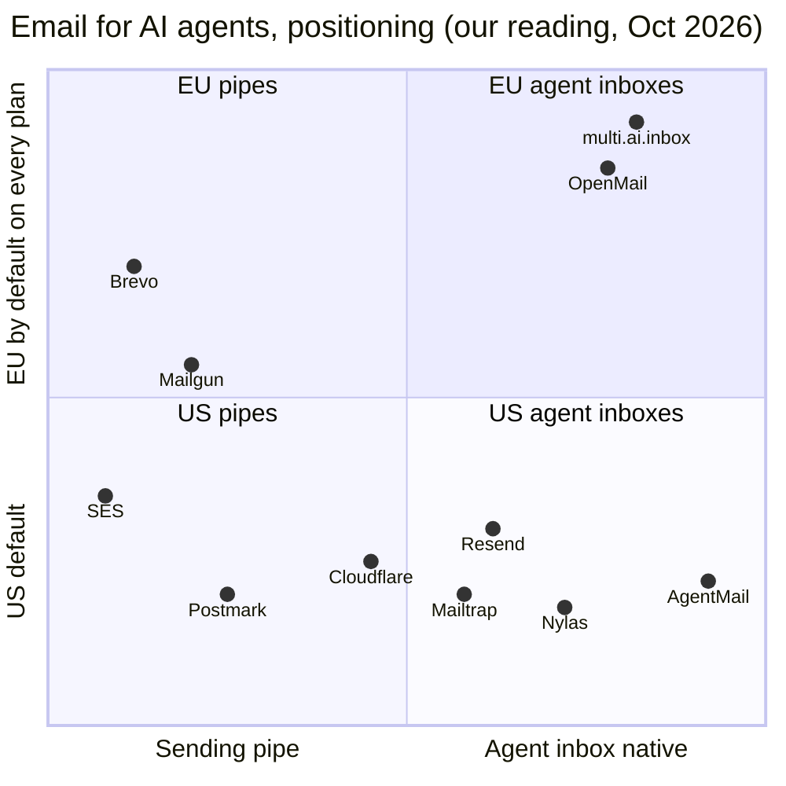

# 11 · Market analysis, go to market and pricing (CRO)

Product: **multi.ai.inbox**, EU hosted email inboxes for AI agents. Owner hat: Chief Revenue Officer. Date: 2026-10-22.
Tags as in the rest of the pack: **[observed]** public evidence with a link, **[estimate]** our own number with stated assumptions, **[decision]** a recommendation for the founder, **[roadmap]** not built yet, never sold as available.

External prices were read on 2026-10-22 unless stated otherwise. USD figures are converted at an assumed **$1 = €0.90** [estimate]; recheck before publishing a price page.

---

## 0. What we can sell today and what we cannot

Selling something that does not exist is the fastest way to lose a regulated buyer. This table is the contract between sales copy and the codebase (source: [README](../../README.md), `internal/core/core.go`, `.claude/context/TODO.md`).

| Sell now (shipped in code) | Label as roadmap (not shipped) | Never claim |
|---|---|---|
| EU hosting on Hetzner Germany, every plan, including free | Web console (sign up, inbox viewer, usage page) | SOC 2 (any type), ISO 27001, BSI C5 |
| REST `/v0` and MCP at `/mcp` with the same API key | Stripe billing, self serve upgrade, invoices | "Certified", "compliant with the AI Act" |
| Inboxes, threads, messages, send, reply, labels, attachments | Pods / multi tenancy, scoped key UI, seats and roles | Dedicated IPs as available today |
| Custom domains with DNS verification | Registrar one click DNS (Namecheap, Infomaniak, Cloudflare) | Self hosted package as available today |
| Signed webhooks (Standard Webhooks and Svix headers) | Drafts, scheduled send, WebSockets, polling | Uptime SLA backed by credits (single server) |
| Gatekeeper: prompt injection heuristics, reply extraction | ML classifier, review queue UI | Customer logos or testimonials (we have none) |
| Agent to agent mail on the platform | IMAP / SMTP access, calendar, SDKs, CLI | |
| Plan limits enforced in code (inboxes, domains, day and month sends, free footer) | 5 minute burst limit, metered overage | |

Today the product is staging only, pre revenue, with no brand domain yet (doc 09, D1). Every GTM step below assumes the P0 list in section 7.8 ships first.

---

## 1. Executive summary

**The bet.** AI agents need their own mailboxes, and the category is proven: AgentMail raised $6M in March 2026 to build an email service for AI agents ([TechCrunch](https://techcrunch.com/2026/03/10/agentmail-raises-6m-to-build-an-email-service-for-ai-agents/)) and keeps EU cloud behind its Enterprise plan ([AgentMail pricing](https://www.agentmail.to/pricing)). Resend, Cloudflare, Nylas and Mailtrap all launched agent inbox features in 2025 and 2026 (section 3). Infrastructure for agents is becoming a commodity in the US; **EU jurisdiction plus agent safety by default** is still thin.

**The wedge.** "Inboxes for AI agents that never leave Germany, with prompt injection screening on every plan, priced in euros." We lead with EU builders and EU regulated teams (legal, fintech, health) who cannot or will not put customer email into a US hyperscaler path, and we win developers through MCP first distribution.

**Honest caveat.** We are not alone in the EU wedge: OpenMail already sells EU residency on every plan from €9 per month and is run from Vilnius ([OpenMail pricing](https://openmail.sh/pricing), [OpenMail blog](https://openmail.sh/blog/best-email-providers-for-ai-agents-2026)). Our differentiation must therefore be German hosting on our own stack, Gatekeeper on every plan, agent to agent mail, AgentMail compatible resource names, a DPA on every paid plan, and a dedicated or self hosted sovereign option, not "EU" alone.

**12 month revenue targets** (November 2026 to October 2027) [estimate]:

| Scenario | Exit MRR (month 12) | Cumulative recognized revenue | Paying orgs at month 12 | Key assumption |
|---|---|---|---|---|
| Conservative | €1,000 | €5K | 25 | Billing ships late (month 3), no enterprise deal |
| **Base** | **€3,000** | **€15K subscriptions + €5K services** | **48 self serve + 1 sovereign or enterprise** | Billing live in week 2, 1,890 signups, 3% signup to paid, 4% monthly paid churn |
| Stretch | €7,500 | €35K | 90 + 3 enterprise | One platform customer at €1,000+ and a Show HN that lands |

Base case math: self serve mix 70% Builder (€15), 20% Growth (€59), 10% Team (€149) gives a blended ARPA of €37 per month; 48 orgs × €37 = €1,790; add ons at 10% = €180; one sovereign or enterprise contract at €1,000 per month. Total about €2,970 MRR.

---

## 2. Market

### 2.1 Segments

| Segment | What they buy | Why email | Size signal |
|---|---|---|---|
| A. AI agent startups | Inbox per agent or per end user, send and receive, webhooks | Sign ups, OTP codes, vendor and support threads | AgentMail customers listed in doc 01; YC backed category |
| B. Platforms embedding email per tenant | Hundreds to thousands of inboxes, isolation, white label | "Email as a column", vertical SaaS agents | Resend and Nylas price inboxes per unit ($1 and $0.40 to $0.20 per agent account) ([Resend](https://resend.com/pricing), [Nylas](https://www.nylas.com/pricing/)) |
| C. Indie and MCP users | 1 to 10 inboxes from Claude Code, Cursor, Codex | Give a personal agent an address | 73% of Stack Overflow 2026 respondents use coding assistants and agents daily ([SO 2026](https://survey.stackoverflow.co/2026/ai)) |
| D. EU regulated teams | Residency, DPA, audit trail, sometimes single tenant | Agents reading client mail, invoices, KYC documents | European sovereign cloud IaaS spend $6.9B (2025) to $12.6B (2026), Gartner via [CSA](https://labs.cloudsecurityalliance.org/research/eu-tech-sovereignty-cloud-ai-enterprise-risk-v1-0-csa-styled/) |

### 2.2 TAM, SAM, SOM (bottom up) [estimate]

All rows below except the first are our assumptions. They are deliberately conservative and should be replaced with funnel data after 90 days.

| Step | Value | Basis |
|---|---|---|
| Developers on GitHub | 180M | [GitHub Octoverse 2025](https://github.blog/news-insights/octoverse/octoverse-a-new-developer-joins-github-every-second-as-ai-leads-typescript-to-1/) [observed] |
| Share actively building agents (prod or serious side projects) | 2% → 3.6M | assumption |
| Share whose agents need their own inbox | 8% → 288K developers | assumption (sign ups, OTP, vendor mail, support) |
| Developers per paying account | 2.5 → 115K accounts | assumption |
| Accounts that pay instead of free tier or DIY (SES, Cloudflare) | 30% → 35K paying accounts | assumption |
| Blended self serve ARPA | €600 per year | assumption (between €15 and €149 plans) |
| **Self serve TAM** | **≈ €21M ARR** | 35K × €600 |
| Platforms and enterprise (segment B and D) | 1,000 accounts × €12K | assumption |
| **Total TAM (near term, 2027 spend pool)** | **≈ €33M ARR** (range €20M to €60M) | sum |
| **SAM**: Europe plus EU sensitive buyers | 25% of self serve (€5.3M) + 30% of platform and enterprise (€3.6M) ≈ **€9M** | assumption: Europe share of agent builders 25% |
| **SOM, 12 months** | **€36K ARR run rate** (base case) ≈ 0.4% of SAM | section 1 |
| SOM ambition, 36 months | 5% of SAM ≈ €450K ARR | target, not forecast |

Top down cross checks (not used in the math): the agentic AI market is put at $7.29B in 2025 growing to $139.19B by 2034, 40.5% CAGR ([Fortune Business Insights](https://www.fortunebusinessinsights.com/agentic-ai-market-114233)); Gartner predicts 40% of enterprise apps will include task specific agents by the end of 2026, up from under 5% in 2025 ([Gartner, Aug 2025](https://www.gartner.com/en/newsroom/press-releases/2025-08-26-gartner-predicts-40-percent-of-enterprise-apps-will-feature-task-specific-ai-agents-by-2026-up-from-less-than-5-percent-in-2025)). Email infrastructure is a small slice of that, which is consistent with a TAM in the tens of millions today.

### 2.3 Trends that help us

| Trend | Evidence | Implication |
|---|---|---|
| MCP is the default tool protocol | MCP Tier 1 SDKs at "close to half a billion downloads a month" ([MCP blog, 2026-07-28](https://blog.modelcontextprotocol.io/posts/2026-07-28/)); 47,267 active servers in the official registry on 2026-10-21 ([Digital Applied](https://www.digitalapplied.com/blog/mcp-adoption-statistics-2026-model-context-protocol), third party count) | MCP directories are a primary channel; registry is crowded, so listing alone is not enough |
| Everyone adds "inboxes for agents" | Resend inboxes at $1 each ([Resend](https://resend.com/pricing)); Cloudflare Email Service public beta "ready for your agents" ([Cloudflare blog](https://blog.cloudflare.com/email-for-agents)); Nylas Agent Accounts ([Nylas](https://www.nylas.com/blog/introducing-nylas-agent-accounts/)) | Generic inbox API is commoditizing; differentiate on jurisdiction, safety and service |
| EU sovereignty is operational, not just policy | ~80% of EU professional cloud spend goes to US companies; June 2026 Technological Sovereignty Package and Cloud and AI Development Act ([CSA](https://labs.cloudsecurityalliance.org/research/eu-tech-sovereignty-cloud-ai-enterprise-risk-v1-0-csa-styled/)) | Procurement questions about provider nationality, not only data location |
| CLOUD Act vs GDPR conflict | A US provider can be compelled to disclose data regardless of where it is stored; CJEU invalidated Privacy Shield in Schrems II ([Duality](https://dualitytech.com/blog/data-sovereignty-vs-data-residency-full-comparison/)) | "EU region of a US vendor" is weaker than "EU company on EU infrastructure"; have counsel confirm the current EU US Data Privacy Framework status before using it in copy |
| EU AI Act obligations are coming, later | Annex III high risk obligations moved to 2 Dec 2027 and Annex I to 2 Aug 2028 by the Omnibus agreement ([Gibson Dunn](https://www.gibsondunn.com/eu-ai-act-omnibus-agreement-postponed-high-risk-deadlines-and-other-key-changes/)) | Sell traceability (message evidence, Gatekeeper verdicts, audit log) as preparation, never as compliance |
| Sector rules for vendors | DORA (finance ICT third parties), NIS2 ([CSA](https://labs.cloudsecurityalliance.org/research/eu-tech-sovereignty-cloud-ai-enterprise-risk-v1-0-csa-styled/)) | Fintech buyers will send vendor questionnaires; prepare the pack before outbound |

### 2.4 Market risks

* Commoditization: Cloudflare gives unlimited inbound routing and outbound at $0.35 per 1,000 on Workers Paid ([Cloudflare pricing](https://developers.cloudflare.com/email-service/platform/pricing/)). Developers comfortable with Workers can build an inbox themselves.
* The agent inbox may become a feature of the big mail providers (Gmail, Microsoft). Not researched in this pass; treat as a strategic unknown.
* Our hosting cost base moved: Hetzner raised the CX33 from €6.49 to €8.49 per month on 15 June 2026 ([Hetzner](https://docs.hetzner.com/general/infrastructure-and-availability/price-adjustment/)). Still cheap, but not free.

---

## 3. Competitive landscape

### 3.1 Table

| Product | Target | Entry paid | Mid tier | EU hosting | MCP | Inbound + threading | Prompt injection protection | Self serve |
|---|---|---|---|---|---|---|---|---|
| **multi.ai.inbox** (us) | EU agent builders, regulated teams | €15 Builder (proposed) | €149 Team (proposed) | Yes, Hetzner DE, all plans | Yes, same key as REST | Yes | Gatekeeper heuristics, all plans | **Not yet** (no console, no billing) |
| AgentMail | AI agent startups | $20 Developer, 10 inboxes, 10K emails ([pricing](https://www.agentmail.to/pricing)) | $200 Startup, 150 inboxes | Enterprise only ("EU region cloud") | Yes | Yes | Agent Armor, beta (doc 08, observed) | Yes |
| OpenMail | Agent builders, EU | €9 Pro + usage, 10 inboxes, 10K emails ([pricing](https://openmail.sh/pricing)) | Usage: €1 per inbox, €0.001 per email | Yes, all plans, run from Vilnius ([blog](https://openmail.sh/blog/best-email-providers-for-ai-agents-2026)) | Not stated on pricing page | Yes | Not stated | Yes |
| Resend | Transactional devs, now inboxes | $20 Pro, 50K emails, 3 inboxes then $1 each ([pricing](https://resend.com/pricing)) | $90 Scale, 100K emails | "Multi region" listed, EU detail not verified | Not verified | Yes (threads, agent access) | Not stated | Yes |
| Mailtrap Agent Inbox | Devs already on Mailtrap | $15 per 10K emails ([Mailtrap](https://mailtrap.io/blog/best-email-api-for-ai-agents/)) | $85 with dedicated IPs ([AgentMail comparison](https://www.agentmail.to/blog/mailtrap-vs-resend-vs-agentmail), competitor source) | Listed as "no" by a competitor ([OpenMail](https://openmail.sh/blog/best-email-providers-for-ai-agents-2026)), not verified | Yes ([Mailtrap](https://mailtrap.io/blog/best-email-api-for-ai-agents/)) | Yes | Not stated | Yes |
| Nylas Agent Accounts | Apps needing email + calendar | Pro $49 per month, +$0.40 per extra agent account, +$0.80 per 1K agent emails ([pricing](https://www.nylas.com/pricing/)) | Annual Pro $43, $0.20 per agent account | Not on pricing page | Yes (CLI installs MCP) ([Nylas CLI](https://cli.nylas.com/guides/why-ai-agents-need-email)) | Yes, plus calendar | Not stated | Yes |
| Cloudflare Email Service | Workers developers | Workers Paid: 3,000 sends included, then $0.35 per 1K; inbound unlimited ([pricing](https://developers.cloudflare.com/email-service/platform/pricing/)) | Same, usage based | US company, global network | Yes, via Cloudflare MCP server ([blog](https://blog.cloudflare.com/email-for-agents)) | Routing to Workers; inbox and threading are DIY | No (DIY) | Yes |
| Postmark | Transactional senders | $15 Basic, 10K, no inbound; $16.50 Pro with inbound ([pricing](https://postmarkapp.com/pricing)) | $18 Platform | Not verified | Skills for coding agents promoted ([pricing page banner](https://postmarkapp.com/pricing)) | Inbound to JSON webhook, no inbox model | No | Yes |
| Mailgun | Transactional and bulk | $15 Basic, 10K, 5 inbound routes ([pricing](https://www.mailgun.com/pricing/)) | $35 Foundation 50K, $90 Scale 100K | Yes, US or EU region | Not verified | Routes, no inbox model | No | Yes |
| SendGrid (Twilio) | Transactional and marketing | $19.95 Essentials ([Twilio](https://www.twilio.com/en-us/products/email-api/pricing)) | $89.95 Pro | Not verified | Not verified | Inbound Parse webhook, no inbox model | No | Yes |
| Amazon SES (cost baseline) | Infra teams | $0.10 per 1K outbound, $0.10 per 1K inbound à la carte ([SES](https://aws.amazon.com/ses/pricing/)) | Dedicated IP $24.95 per month | eu-central-1 region of a US provider | No | Raw MIME, DIY | No | Yes |
| Brevo (our relay) | SMB marketing and transactional | Free 300 per day; Starter $9 for 5K ([Brevo](https://www.brevo.com/products/transactional-email/)) | about $65 to $82 for 100K (third party: [Mailblast](https://www.mailblast.io/blog/comparisons/brevo-pricing-explained), [Dreamlit](https://dreamlit.ai/blog/brevo-review)) | EU provider (doc 09, D2) | No | Not an inbox product | No | Yes |

Pages that could not be fully read: the SendGrid pricing URL redirected to a Twilio overview without prices (prices above come from Twilio's own pricing page excerpt in search); Brevo's pricing pages did not expose volume tiers (third party figures used and marked); OpenMail's home page did not state its cloud provider, MCP or prompt injection features.

### 3.2 Positioning map

Positioning statement [decision]: *For EU teams putting AI agents in front of real email, multi.ai.inbox gives every agent its own inbox hosted in Germany, screens every inbound message for prompt injection before your agent reads it, and keeps the API shape developers already know. Unlike US agent inbox APIs, EU residency and a DPA are on every plan, and a dedicated sovereign deployment is available when procurement asks for it.*

### 3.3 Where we win and where we lose (honest)

| We win when | We lose when |
|---|---|
| The buyer asks "where is the data and who owns the provider?" and the answer must be EU on both | The buyer needs SOC 2 today (AgentMail Startup includes a SOC 2 report) |
| The agent reads untrusted inbound mail and the team fears prompt injection | The team wants the cheapest EU option: OpenMail Pro is €9 vs our €15 |
| Agents email each other on one platform (agent to agent mail, no relay cost) | The buyer wants a console, drafts, WebSockets, IMAP or calendar today |
| The buyer wants a person: founder led onboarding, deliverability help, migration | The buyer needs scale proof (AgentMail: 10M+ inboxes, doc 01) or a multi region SLA |
| Procurement wants single tenant or self hosted later | The developer already lives in Cloudflare Workers or Resend and needs only 3 inboxes |
| Price in EUR with an invoice that has EU VAT handling | The deal depends on a dedicated IP before we have port 25 and warmed IPs |

---

## 4. ICPs and buyer personas

| ICP | Persona | Pains | Triggers | Objections | Channels | First offer |
|---|---|---|---|---|---|---|
| 1. AI agent startups (EU first, then global) | CTO or founding engineer, 2 to 20 people | Gmail accounts per agent get blocked; OAuth on a human mailbox is fragile; transactional APIs do not thread | Launching a feature where the agent must receive mail (OTP, vendor replies) | "AgentMail is the default", "you are one person", "no SOC 2" | MCP directories, GitHub, HN, EU founder communities, accelerators | Builder or Growth, startup program, AgentMail migration guide |
| 2. Platforms embedding email per tenant | Head of platform or product engineer at vertical SaaS | Need hundreds of isolated inboxes, per tenant domains, cost per inbox | Customer asks "can my agent have its own address?" | Pods and scoped keys not shipped; single server | Founder outbound, partnerships, integration directories | Platform design partner package (section 6) |
| 3. Indie and MCP users | Solo developer using Claude Code, Cursor, Codex | Wants an address for a personal agent in 2 minutes, no DNS | Reads a post or sees the MCP listing | Free tier footer; trust of a new brand | MCP registry, skill repo, Reddit, X, YouTube demos | Free, then Agent Inbox Starter |
| 4a. EU legal tech and law firms | Innovation lead, IT partner | Client privilege; agents triage inbound client mail | Pilot of an intake or docketing agent | Confidentiality, certifications, liability cap | Founder led, legal tech meetups, referrals | EU Sovereign pilot + DPA |
| 4b. EU fintech | CTO, compliance officer | DORA third party risk, KYC documents arrive by email | Ops automation agent, collections agent | Vendor questionnaire, exit plan, incident reporting | Founder outbound, fintech communities | Team + security pack, then Sovereign |
| 4c. Health (clinics, healthtech) | CTO of a healthtech startup | GDPR Art 9 data in referrals and lab mail | Patient intake or scheduling agent | Health data processing terms, hosting certification | Healthtech accelerators | Sovereign only, after counsel review |
| 4d. Public sector | IT procurement, municipal innovation units | Sovereignty rules, procurement law | Pilot funds | Tenders, certifications we lack | Not in the first 12 months | None yet [decision] |

Persona one liner for the site: "Your agent gets an inbox. Your data stays in Germany. Your prompts stay yours."

---

## 5. Pricing and packaging

### 5.1 Value metric

| Candidate | Pros | Cons | Verdict |
|---|---|---|---|
| **Inboxes** | Maps to how customers think (one per agent, per user, per tenant); predictable bills; market norm (AgentMail, Resend, OpenMail, Nylas all price inboxes) | Idle inboxes cost us almost nothing, so heavy senders could underpay | **Primary metric** [decision] |
| Emails (sends) | Tracks our only real variable cost (relay) | Agents are bursty; per email pricing feels like a transactional ESP and invites comparison with SES at $0.10 per 1K | **Guardrail metric**: included quota per plan, add on packs, opt in overage |
| Seats | Simple for SaaS | Agents are the users, not humans; we have no console or roles yet | **Not charged** until roles ship; then generous included seats |

Inbound mail is **not** counted against send quotas (the code limits sends only). Inbound is covered by fair use (10× the monthly send quota) and storage fair use.

### 5.2 Plans (EUR, excl. VAT) [decision]

Yearly = 10 × monthly (2 months free, about 17% off).

| | Free | Builder | **Growth** (new) | Team | Enterprise / Sovereign |
|---|---|---|---|---|---|
| Monthly | €0 | €15 | €59 | €149 | from €990 |
| Yearly | €0 | €150 | €590 | €1,490 | annual contract |
| Inboxes | 3 | 10 | 50 | 150 | custom |
| Sends per day | 100 | 1,000 | 2,500 | 15,000 | custom |
| Sends per month | 3,000 | 10,000 | 40,000 | 150,000 | custom |
| Custom domains | 1 | 5 | 20 | 50 | custom |
| "Sent via" footer | yes | no | no | no | no |
| Gatekeeper (injection screening) | yes | yes | yes | yes | yes + tuning |
| Webhooks, MCP, agent to agent | yes | yes | yes | yes | yes |
| Data region | EU (DE) | EU (DE) | EU (DE) | EU (DE) | EU (DE), dedicated server option |
| DPA | n/a | yes | yes | yes | negotiated |
| Support | community | email, 2 business days | email, 1 business day | email, 1 business day + onboarding call | named contact, response targets |

Alignment with code (`internal/core/core.go`): Free, Builder and Team limits above are exactly the code limits. **Proposed code changes:**
1. Add a `growth` plan: 50 inboxes, 20 domains, 2,500 per day, 40,000 per month. Reason: the €15 to €149 gap is 10×; AgentMail fills it with add ons, we want a self serve step that a 5 person startup buys without talking to us.
2. Implement the 5 minute burst limit (known gap in TODO) at 10% of the daily cap, mirroring AgentMail's 100 and 1,500 per 5 minutes on Developer and Startup ([AgentMail](https://www.agentmail.to/pricing)).
3. Add a `sovereign` plan flag for single tenant deployments (no shared IP pool, custom limits).

Why not undercut harder: OpenMail is €9 ([OpenMail](https://openmail.sh/pricing)). We hold €15 because Gatekeeper and German hosting are features they do not state, and because at our scale, ten more customers at €15 matter less than avoiding a race to the bottom. Test it (5.9).

### 5.3 Add ons (paid plans) [decision]

| Add on | Price | Note |
|---|---|---|
| Extra inbox | €1.50 per month (€15 per year) | AgentMail $2, Resend $1, OpenMail €1 |
| Extra custom domain | €1.50 per month | AgentMail $2 |
| Extra 1,000 sends per month | €1.50 per month | raises daily and burst caps proportionally |
| Seat | €0 until roles ship | then €5 per month after included seats |
| Dedicated IP [roadmap] | €49 per month | only after port 25 and warm up; Team and above |
| Priority support | €99 per month | 4 business hour first response, shared Slack or Matrix channel |
| Extended retention or 24 h expiry [roadmap] | €10 per month | regulated buyers ask for both directions |
| EU Sovereign, dedicated | from €990 per month + €1,500 setup | single tenant on dedicated Hetzner hardware in DE |
| EU Sovereign, self hosted licence [roadmap] | from €12,000 per year | needs packaging; proprietary licence allows commercial licensing |

### 5.4 Overage policy

* Default: **hard cap**. The API returns `429 limit_exceeded` (already in code). We email the owner at 80% and 100% of the daily and monthly quota [roadmap: alerts].
* Opt in pay as you go on paid plans after Stripe metering ships: €1.50 per extra 1,000 sends, billed in arrears, with a customer set monthly ceiling.
* Never auto upgrade a plan. Never bill overage on Free.
* Inbound above 10× fair use: we contact the customer before any action; we do not drop inbound mail silently.

### 5.5 Free tier guardrails

| Control | Status |
|---|---|
| 3 inboxes, 100 sends per day, 3,000 per month, footer | in code |
| Email verification and disposable domain blocklist at sign up; hCaptcha | P0 with self sign up (doc 08, T1) |
| New org warm up: max 25 distinct external recipients per day for the first 7 days | proposed |
| Per org bounce > 5% or complaint > 0.1% pauses sending automatically | proposed, PRD target |
| Custom domain on free only after DNS verification, one per org | in code (1 domain) |
| Separate outbound pool for free vs paid once on own IPs | roadmap (doc 09 risk) |
| No cold outreach, enforced by AUP and per recipient heuristics | AUP at launch |
| Inactive 60 days: sending paused; 120 days: inboxes deleted with 2 notices; deleted addresses quarantined 90 days | proposed (doc 08, T6) |
| Agent self sign up can only email its human until claimed | roadmap (doc 08, T12) |

### 5.6 Enterprise, startup, nonprofit and education

| Program | Offer | Eligibility |
|---|---|---|
| Enterprise | Custom limits, DPA negotiation, security questionnaire support, response targets, invoice billing, annual prepay. From €990 per month | Over 150 inboxes, or legal and security review required |
| **Startup program** | 50% off Growth or Team for 12 months, or 6 months of Builder free | Pre seed and seed, under €3M raised, building agents. Benchmark: OpenMail gives €500 credit over 6 months ([OpenMail](https://openmail.sh/pricing)) |
| Design partner (first 10) | Team at €49 per month locked 12 months, in exchange for a monthly call and permission to cite them by name only if they agree in writing | EU agent startups and platforms |
| Nonprofit | 50% off paid plans | Registered nonprofits (Resend offers the same 50% ([Resend](https://resend.com/pricing))) |
| Education | Free Builder for courses and student projects, renewed per semester | University email + course page |

### 5.7 Unit economics [estimate]

Inputs:

| Input | Value | Source |
|---|---|---|
| Server | CX33 €8.49 per month excl. IPv4 | [Hetzner](https://docs.hetzner.com/general/infrastructure-and-availability/price-adjustment/) |
| Object Storage base | €6.49 per month | [Better Stack review](https://betterstack.com/community/guides/web-servers/hetzner-cloud-review/) (third party) |
| Fixed platform cost incl. IPv4, backups, domain, monitoring free tiers | ≈ €20 per month | estimate |
| Capacity of one CX33 | ≈ 2,000 active inboxes, 500K messages per month | estimate, must be load tested |
| Relay (Brevo) | $65 to $82 per 100K → €0.59 to €0.74 per 1K; we use **€0.75 per 1K** | third party, see table 3.1 |
| Direct delivery after port 25 opens | ≈ €0.02 per 1K (CPU, bandwidth on fixed servers) | estimate |
| SES baseline (rejected, no AWS per D2) | $0.10 per 1K ≈ €0.09 | [SES](https://aws.amazon.com/ses/pricing/) |
| Agent to agent mail on platform | ≈ €0 relay cost | local delivery, in code |
| Average stored message incl. attachments | 75 KB → 1K messages ≈ 75 MB | estimate |
| Payment fees | 1.5% + €0.25 per charge | assumption for EEA cards; verify on Stripe before launch |

Derived costs:
* **Per inbox per month:** €20 / 2,000 = **€0.01** fixed allocation.
* **Per 1,000 emails:** fixed allocation €20 / 500 = €0.04, storage ≈ €0.001, plus relay **€0.75** (Brevo) or **€0.02** (direct). Total ≈ **€0.79 via Brevo, €0.06 direct, €0.04 agent to agent**.

Gross margin per plan (cost = sends × per 1K cost + inboxes × €0.01 + payment fee; support time excluded):

| Plan | Price | Worst case (100% of sends, all external, Brevo) | Typical (30% of sends used, Brevo) | After direct delivery (100% used) |
|---|---|---|---|---|
| Free | €0 | cost €2.40 per org | cost ≈ €0.27 per org (10% used) | cost ≈ €0.21 |
| Builder | €15 | cost €8.48 → **43%** | cost €2.95 → **80%** | cost €1.18 → **92%** |
| Growth | €59 | cost €33.24 → **44%** | cost €11.12 → **81%** | cost €4.04 → **93%** |
| Team | €149 | cost €122.49 → **18%** | cost €39.54 → **73%** | cost €12.99 → **91%** |
| Extra 1K sends add on | €1.50 | cost €0.79 → 47% | n/a | cost €0.06 → 96% |

Takeaways:
1. **The Brevo relay is the margin.** Getting Hetzner port 25 open, warming our own IPs and delivering directly moves every plan above 90% gross margin. It is a revenue task, not only an ops task.
2. Until then, Team is acceptable only because typical usage is far below quota. Set a relay cost alarm at €50 per month and keep a fair use clause on Team.
3. Free cost is real but small: 500 free orgs at typical use ≈ €135 per month. Brevo's free 300 per day ([Brevo](https://www.brevo.com/products/transactional-email/)) absorbs the first ~9,000 sends per month.

### 5.8 Price page facts we must not get wrong

* Prices excl. VAT, EUR only at launch; reverse charge for EU B2B with a VAT ID.
* State "hosted in Germany (Hetzner)" and list subprocessors (Hetzner, Brevo, Stripe once live).
* Roadmap items appear in a separate "Coming next" column, never as checkmarks.
* No SOC 2 badge, no "enterprise grade", no uptime SLA percentage until we run more than one node.

### 5.9 Price tests to run (sequential, low traffic)

Our traffic is too low for A/B significance. Run sequential cohorts of 4 weeks and 20 Van Westendorp interviews with design partners.

| # | Test | Variants | Success metric |
|---|---|---|---|
| T1 | Builder price | €15 vs €19 | paid conversion within 30 days; revenue per signup |
| T2 | Growth tier presence | with vs without Growth | share of Team upgrades vs Builder add on stacking |
| T3 | Annual discount | 2 months free vs 20% | share of annual prepay |
| T4 | Free with custom domain | 1 domain vs shared domain only | activation rate, abuse rate |
| T5 | Founding member offer | Builder yearly €99 for the first 100 vs none | signups to paid in launch weeks |
| T6 | Inbox add on | €1.50 vs €2 | add on attach rate |

---

## 6. Productized packages and services

| Package | For | Contents | Price |
|---|---|---|---|
| **Agent Inbox Starter** | Indie and MCP users (ICP 3) | Builder yearly, one line MCP setup (`claude mcp add ...`), one custom domain verified, starter prompts for "agent that handles sign ups and OTP" | €150 per year (test €99 founding member) |
| **Platform** (design partner) | ICP 2 | Team limits with 500 inboxes, per tenant domains, volume inbox pricing €0.50 per inbox above 500; pods and white label are **[roadmap]** and co designed with the partner | €349 per month, design partner €249 locked 12 months |
| **EU Sovereign Dedicated** | ICP 4a, 4b | Single tenant deployment on dedicated Hetzner hardware in Germany, own DKIM keys, separate outbound IP once direct delivery is live, DPA, quarterly security review call | from €990 per month + €1,500 setup |
| **EU Sovereign Self Hosted** [roadmap] | Teams that cannot use SaaS | Licensed binaries, k3s manifests, upgrade support | from €12,000 per year |

Professional services (founder delivered, max 2 engagements per month to protect build time):

| Service | Scope | Price |
|---|---|---|
| Deliverability setup | SPF, DKIM, DMARC, MTA-STS, warm up plan, one domain | €490 fixed |
| Migration from AgentMail | Map inboxes and webhooks, switch base URL and keys, verify signatures, DNS cutover, 30 days support | €990 fixed (free for annual Team) |
| Migration from Gmail or Workspace agent mailboxes | Export, recreate inboxes, routing, DNS cutover | €1,490 fixed |
| Security and DPIA pack | Completed questionnaire, architecture and data flow diagram, subprocessors, DPIA input | €750 fixed |
| Custom integration | Framework or internal tooling | €800 per day |

---

## 7. Go to market plan

### 7.1 Motions

| Motion | Target ICP | Tactics | Cost |
|---|---|---|---|
| Product led, agent first | 1, 3 | Official MCP Registry, Smithery, Glama, mcp.so listings; public Claude Code skill repo; `llms.txt` and `.md` docs; "copy this prompt to your agent" CTA; GitHub examples repo | €0 |
| Content and SEO | 1, 3, 4 | Topic list in 7.3; comparison and migration pages; one post per week | €0 (founder time + agents) |
| Community | 1, 3 | HN, r/LocalLLaMA, r/AI_Agents, MCP and framework Discords, EU founder Slack groups | €0 |
| Partnerships | 1, 2 | Framework integrations (LangChain, Vercel AI SDK, OpenAI Agents SDK), EU accelerators' perk lists, n8n community node; Hetzner partner or marketplace route is **unvalidated**, ask Hetzner before investing | €0 |
| Founder led sales | 2, 4 | 50 account list of EU legal tech, fintech, healthtech agent builders; warm intros; 20 discovery calls | €0 to €50 per month (LinkedIn trial optional) |

### 7.2 Messaging pillars

1. **Your agent's inbox, in Germany.** EU hosted on every plan, EU company, DPA on paid plans.
2. **Screened before your agent reads it.** Gatekeeper verdict and evidence on every inbound message.
3. **Same shape you already know.** REST, MCP and webhooks with familiar resources; migrate by changing the base URL [verify with a compatibility test suite before claiming].

### 7.3 Content and SEO topics

| Topic | Intent | Format |
|---|---|---|
| "AgentMail alternative in the EU" | switching | comparison page (factual, cited) |
| "Give Claude Code an email address" | indie, MCP | tutorial + video |
| "Prompt injection through email: 12 real patterns and how to screen them" | security | research post with Gatekeeper rules |
| "GDPR and AI agents reading email: a checklist" | regulated | guide, reviewed by counsel |
| "OTP and sign up flows for agents without Gmail" | startup | tutorial |
| "DORA third party questions for an email vendor, answered" | fintech | security page section |
| "Agent to agent email: when your agents talk to each other" | differentiation | post + demo |
| "Webhook signature verification (Standard Webhooks / Svix) in Go, Python, TS" | dev | docs page |
| "Email API for AI agents compared, EU edition" | evaluation | comparison post, updated quarterly |

### 7.4 Launch sequence (12 weeks, starting Monday 2026-10-26)

| Week | Dates | Product (must ship) | GTM |
|---|---|---|---|
| 1 | Oct 26 | Brand and shared domain bought (D1); legal pages: Terms, Privacy, AUP, DPA, subprocessors | Pricing page draft; 50 account target list; waitlist on landing |
| 2 | Nov 2 | Stripe Payment Links + manual plan switch (`mai admin org-plan`) as concierge billing; Hetzner port 25 ticket | Invite 10 design partners; startup program page |
| 3 | Nov 9 | Minimal self sign up (email verify, captcha, API key), usage endpoint | Docs quickstart, `llms.txt`, "copy to your agent" prompt |
| 4 | Nov 16 | MCP setup one liner; public skill repo | Submit to MCP Registry, Smithery, Glama, mcp.so |
| 5 | Nov 23 | Usage page and 80% / 100% limit emails | Private beta: 20 orgs; collect activation data |
| 6 | Nov 30 | Fixes from beta; burst limit | 3 cornerstone posts (Claude Code email, injection patterns, EU comparison) |
| 7 | Dec 7 | Status page, security page | **Show HN** + r/LocalLLaMA + r/AI_Agents |
| 8 | Dec 14 | Stripe Checkout + Customer Portal (replaces Payment Links) | Product Hunt; EU founder communities |
| 9 | Dec 21 | Console v1: inbox list, thread viewer, webhook log (holiday week, light GTM) | Year end post: "what agents emailed us about" (aggregate only) |
| 10 | Jan 4 | AgentMail migration guide + compatibility tests | Founder outbound to regulated list, 30 accounts |
| 11 | Jan 11 | Growth plan in code; add ons in Stripe | First framework integration PR (LangChain or Vercel AI SDK) |
| 12 | Jan 18 | Security and DPIA pack; sovereign deployment runbook | Pricing test readout; OKR review; decide dedicated tier timing |

### 7.5 Channel budget (zero to minimal)

| Item | Monthly | Note |
|---|---|---|
| Domains (brand + shared) | ≈ €5 amortized | estimate |
| Infra | ≈ €20 | section 5.7, already needed |
| Analytics, errors, status page | €0 | PostHog EU, Sentry, Upptime free tiers (doc 07) |
| Stripe | pay per transaction | no fixed fee |
| Optional: one EU meetup or sponsorship per quarter | €0 to €100 | only if a design partner prospect attends |
| **Total** | **≈ €25 to €125** | |

### 7.6 Funnel metrics and targets

| Stage | Definition | Target (first 90 days) | Target (month 12) |
|---|---|---|---|
| Visitor to signup | signups / unique site visitors | 4% | 4% |
| Signup to first inbox | created an inbox within 24 h | 70% | 75% |
| Signup to first email (activation) | received or sent a message within 24 h | 40% (PRD target) | 50% |
| Activated to weekly active | inbox with traffic in week 2 | 35% | 45% |
| Free to paid | paid within 90 days of signup | 3% | 4% |
| Paid monthly churn | logo churn | under 6% | under 4% |
| Net revenue retention | 12 month, add ons included | n/a | 110% (PRD) |

Volume needed for base case: 1,890 signups in 12 months at 4% conversion ≈ 47K site visitors [estimate].

### 7.7 Enterprise sales process

| Stage | Exit criteria | Probability |
|---|---|---|
| 1. Lead | Fits ICP 2 or 4, named contact | 5% |
| 2. Qualified | Agent in pilot or production, EU residency is a stated requirement, budget owner known, timeline under 6 months | 15% |
| 3. Technical validation | Sandbox org running their agent; Gatekeeper and webhooks tested | 35% |
| 4. Security and legal review | Questionnaire answered, DPA redlines received, subprocessors accepted | 55% |
| 5. Proposal | Package, price and term sent | 70% |
| 6. Closed won | Signed order and DPA, first invoice | 100% |
| 7. Onboarded | Production traffic, success criteria met, 30 day check in | n/a |

Rules: no custom code in deals without a price; no SLA credits until two node setup exists; every security answer must be traceable to doc 08 or code.

### 7.8 What the product must ship to support GTM

| Priority | Item | Why | Status |
|---|---|---|---|
| P0 | Brand domain + shared inbox domain | Nothing can launch without addresses | open (D1) |
| P0 | Legal: Terms, Privacy, AUP, DPA, subprocessors | Regulated buyers and Stripe require them | not started |
| P0 | Self sign up with abuse controls | Product led motion | not started |
| P0 | Billing: Stripe Payment Links now, Checkout + Portal by week 8 | Revenue | not started |
| P0 | Usage endpoint and page, limit alerts | Upgrade trigger | not started |
| P0 | Port 25 approval and direct delivery plan | Margin (5.7) and dedicated IP add on | ticket pending |
| P1 | Console v1 (inboxes, threads, webhooks log) | Debugging, trust, demos | roadmap |
| P1 | Pricing page, security page, status page | Conversion and trust | partial (landing exists) |
| P1 | Growth plan, burst limit, add ons | Packaging | code change |
| P1 | AgentMail compatibility tests + migration guide | Switching motion | roadmap |
| P1 | TypeScript and Python SDKs (generated) | Developer adoption | roadmap |
| P2 | Pods, scoped keys, seats and roles | Platform package | roadmap |
| P2 | Drafts, WebSockets, review queue | Feature parity | roadmap |
| P2 | Sovereign deployment automation, self host package | Enterprise package | roadmap |
| P2 | SOC 2 Type I readiness | Only at €10K MRR (doc 08) | later |

### 7.9 Pricing page and onboarding requirements

Pricing page: plan table from 5.2 with monthly / yearly toggle; add ons; "Coming next" column for roadmap; FAQ (data location, subprocessors, overage, inbound counting, cancellation, VAT); "Talk to the founder" link (Cal.com) for Sovereign; a plain text pricing page for agents at `/pricing.md`.

Onboarding (target: first email in under 2 minutes, PRD G1):
1. Sign up (email, captcha) → API key shown once.
2. Page offers three paths: cURL, MCP one liner, "paste this prompt into your agent".
3. First inbox created on the shared domain; a test email is sent to it automatically and shows up with its Gatekeeper verdict.
4. Nudge to add a webhook; then to add a custom domain (day 2 email).
5. Day 5 email: usage summary; day 10: upgrade prompt only if the org passed 50% of a quota.

---

## 8. 90 day OKRs (2026-10-26 to 2027-01-24) and KPI dashboard

| Objective | Key results |
|---|---|
| O1. Make it buyable | KR1 Stripe live (Payment Links by Nov 6, Checkout by Dec 18). KR2 Self sign up live by Nov 13. KR3 Legal pack and security page published by Nov 6. |
| O2. Prove pull | KR1 300 signups. KR2 40% activation within 24 h. KR3 10 paying orgs and €400 MRR. KR4 5 design partners, at least 2 in EU regulated sectors. |
| O3. Own the agent channel | KR1 Listed in 4 MCP directories. KR2 3 cornerstone posts live, 1 ranking on page one for an "EU" agent email query. KR3 1 framework integration merged. |
| O4. Stay clean and up | KR1 Complaint rate under 0.1%, bounce under 2%. KR2 Zero cross tenant incidents. KR3 API availability 99.5% measured by external probe. KR4 Port 25 approved or alternative direct path decided. |

KPI dashboard (weekly review, PostHog EU + Postgres queries + Stripe):

| KPI | Definition | Source | Cadence | 90 day target |
|---|---|---|---|---|
| Weekly active inboxes (north star) | inboxes with ≥ 1 inbound or outbound message in 7 days | Postgres | weekly | 500 |
| Signups | new orgs | Postgres | weekly | 300 cumulative |
| Activation | % orgs with first message within 24 h | Postgres | weekly | 40% |
| Time to first email | p50 minutes from signup to first message | Postgres | weekly | under 2 min |
| Paying orgs, MRR, ARPA | Stripe subscriptions | Stripe | weekly | 10, €400, €40 |
| Free to paid (90 day cohort) | paid / signups by cohort | Stripe + Postgres | monthly | 3% |
| Quota pressure | % orgs above 80% of any limit | Postgres | weekly | tracked |
| Relay cost | Brevo spend and cost per 1K | Brevo invoice | monthly | under €50 |
| Gross margin | (revenue minus infra, relay, fees) / revenue | finance sheet | monthly | above 70% |
| Deliverability | bounce %, complaint % per org and global | sender events | daily | under 2%, under 0.1% |
| Gatekeeper | % inbound flagged review / blocked; false positive reports | Postgres | weekly | tracked |
| Webhook success | delivered within retry window | dispatcher log | daily | 99.5% |
| Pipeline | open enterprise opportunities by stage, weighted value | CRM sheet | weekly | €3K weighted MRR |
| Founder time split | % hours build / sell / support | self report | weekly | 60 / 25 / 15 |

---

## 9. Risks and mitigations

| Risk | Likelihood | Impact | Mitigation |
|---|---|---|---|
| Deliverability and abuse burn the shared reputation (Brevo account or our IPs) | high | high | Free caps already in code; warm up, bounce and complaint breakers; AUP with no cold outreach; separate free and paid pools once on own IPs; manual review of first 100 orgs |
| Brevo suspends our relay account because of a customer | medium | high | Keep a second relay configured (decision needed, AWS excluded by D2); push direct delivery after port 25 |
| AgentMail adds EU region to all plans | medium | high | Compete on EU company plus German hosting, Gatekeeper on every plan, services and sovereign package, EUR invoicing; the CLOUD Act argument still applies to a US vendor's EU region ([Duality](https://dualitytech.com/blog/data-sovereignty-vs-data-residency-full-comparison/)) |
| OpenMail wins the EU wedge on price | high | medium | Do not race below €9; differentiate on safety, German hosting, agent to agent, sovereign; partner with EU accelerators first |
| Resend, Cloudflare, Nylas bundle agent inboxes cheaply | high | medium | Avoid generic positioning; target buyers who need EU jurisdiction and injection screening; keep migration easy both ways to lower fear |
| Gmail or Microsoft ship native agent mailboxes | unknown (not researched) | high | Watch quarterly; our value is EU jurisdiction and agent first API, not the mailbox itself |
| Solo founder capacity | high | high | Concierge billing before full console; max 2 service engagements per month; no public sector; generated SDKs; coding agents per area; ruthless P0 list |
| Single server outage hurts trust with regulated buyers | medium | high | No SLA promises; status page; nightly backups (in place); second node before first Sovereign customer |
| Over claiming compliance | low | high | Section 0 table is binding for all copy; counsel review of DPA and AI Act wording |
| Prompt injection incident at a customer despite Gatekeeper | medium | high | Market it as screening, not a guarantee; verdict and evidence in payload; docs on tool level confirmation (doc 08) |
| Hetzner price increases again | medium | low | Costs are a small share of price at current margins (5.7) |

---

## 10. Sources (read 2026-10-22)

AgentMail [pricing](https://www.agentmail.to/pricing), [TechCrunch funding](https://techcrunch.com/2026/03/10/agentmail-raises-6m-to-build-an-email-service-for-ai-agents/), [comparison blog](https://www.agentmail.to/blog/mailtrap-vs-resend-vs-agentmail); OpenMail [pricing](https://openmail.sh/pricing), [comparison blog](https://openmail.sh/blog/best-email-providers-for-ai-agents-2026); [Resend pricing](https://resend.com/pricing); [Postmark pricing](https://postmarkapp.com/pricing); [Mailgun pricing](https://www.mailgun.com/pricing/); [Twilio SendGrid pricing](https://www.twilio.com/en-us/products/email-api/pricing); [Amazon SES pricing](https://aws.amazon.com/ses/pricing/); [Brevo transactional](https://www.brevo.com/products/transactional-email/), [Mailblast on Brevo](https://www.mailblast.io/blog/comparisons/brevo-pricing-explained), [Dreamlit on Brevo](https://dreamlit.ai/blog/brevo-review); Cloudflare [pricing](https://developers.cloudflare.com/email-service/platform/pricing/), [blog](https://blog.cloudflare.com/email-for-agents); Nylas [pricing](https://www.nylas.com/pricing/), [Agent Accounts launch](https://www.nylas.com/blog/introducing-nylas-agent-accounts/), [CLI guide](https://cli.nylas.com/guides/why-ai-agents-need-email); [Mailtrap comparison](https://mailtrap.io/blog/best-email-api-for-ai-agents/); [MCP blog](https://blog.modelcontextprotocol.io/posts/2026-07-28/); [Digital Applied MCP stats](https://www.digitalapplied.com/blog/mcp-adoption-statistics-2026-model-context-protocol); [Gartner agents prediction](https://www.gartner.com/en/newsroom/press-releases/2025-08-26-gartner-predicts-40-percent-of-enterprise-apps-will-feature-task-specific-ai-agents-by-2026-up-from-less-than-5-percent-in-2025); [Fortune Business Insights](https://www.fortunebusinessinsights.com/agentic-ai-market-114233); [Stack Overflow 2026 AI](https://survey.stackoverflow.co/2026/ai); [GitHub Octoverse](https://github.blog/news-insights/octoverse/octoverse-a-new-developer-joins-github-every-second-as-ai-leads-typescript-to-1/); [CSA EU sovereignty](https://labs.cloudsecurityalliance.org/research/eu-tech-sovereignty-cloud-ai-enterprise-risk-v1-0-csa-styled/); [Duality on CLOUD Act](https://dualitytech.com/blog/data-sovereignty-vs-data-residency-full-comparison/); [Gibson Dunn AI Act Omnibus](https://www.gibsondunn.com/eu-ai-act-omnibus-agreement-postponed-high-risk-deadlines-and-other-key-changes/); [Hetzner price adjustment](https://docs.hetzner.com/general/infrastructure-and-availability/price-adjustment/); [Better Stack Hetzner review](https://betterstack.com/community/guides/web-servers/hetzner-cloud-review/).

Not researched in this pass: Gmail and Microsoft agent mailbox plans, Stripe EEA fees, Hetzner IPv4 and Object Storage included quotas, Atomic Mail and Robotomail pricing, current EU US Data Privacy Framework litigation status.

## 11. Open questions for the founder

1. Do we accept a **€15 Builder** above OpenMail's €9, or test €9 to €12 from day one?
2. Approve the new **Growth plan** (€59, 50 inboxes, 40K sends) and the burst limit as code changes?
3. **Second relay** for resilience now that AWS is excluded: Scaleway TEM, Mailjet, or none until port 25?
4. Is the **company legally EU based** (entity, VAT ID, bank)? The sovereignty pitch depends on it.
5. Who drafts the **DPA, Terms and AUP** (template plus counsel, budget)?
6. Will you take **professional services** at all, and the cap of 2 engagements per month?
7. Is a **dedicated sovereign deployment** acceptable operationally before a second node and on call cover exist?
8. Should the **self hosted licence** stay on the roadmap given the proprietary licence decision (D6)?
9. Can we name **design partners** publicly if they agree in writing, and what do we offer for it?
10. Brand name and domain (D1): the launch calendar starts the week it is decided.
