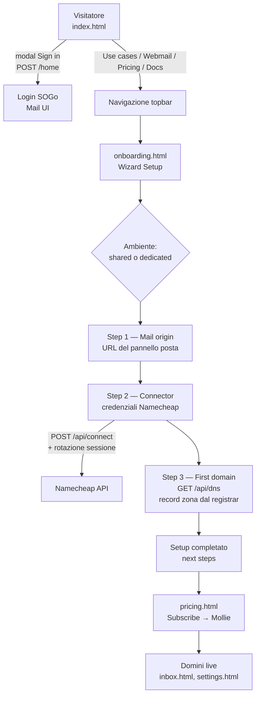
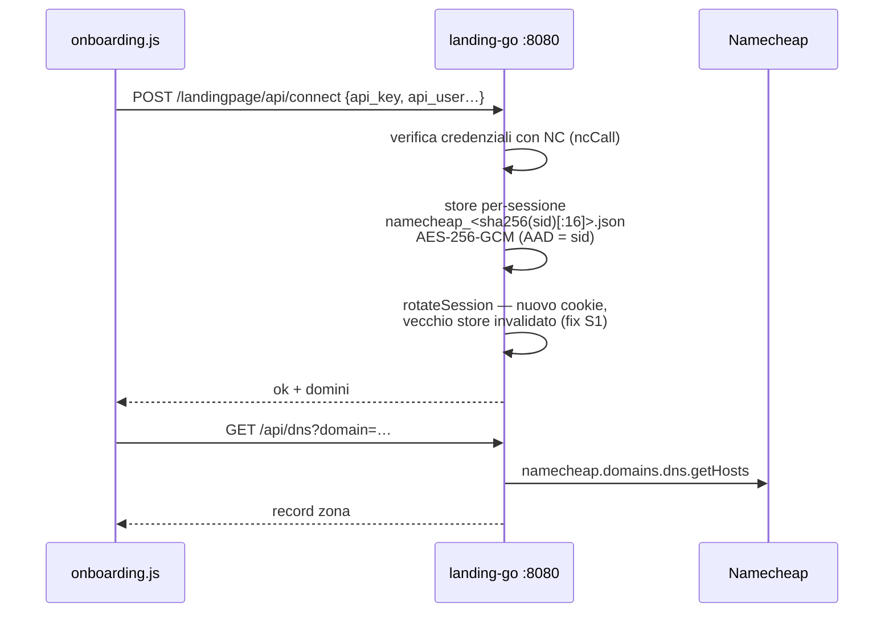
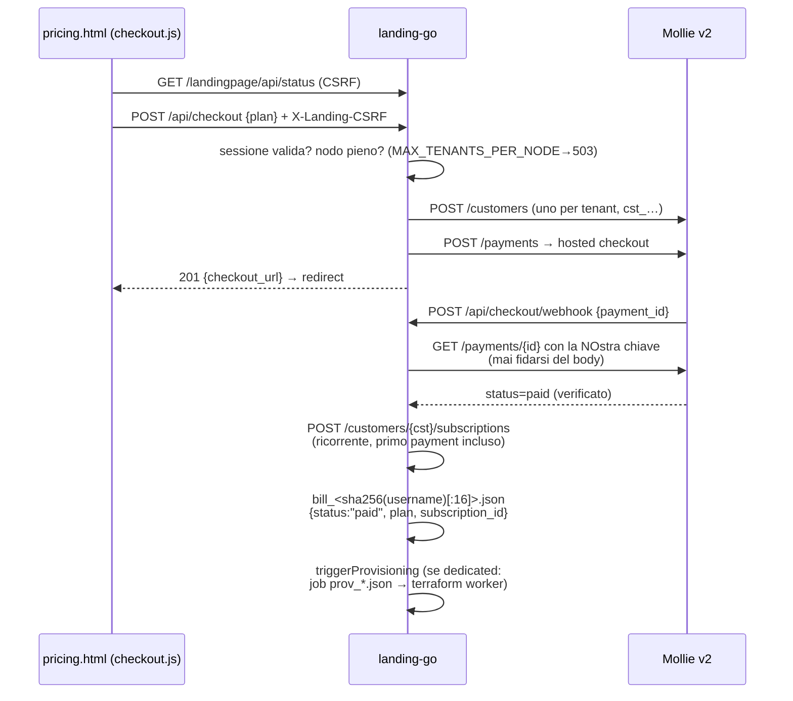
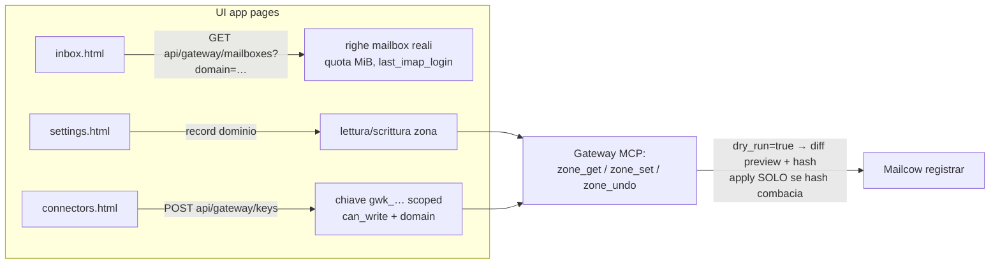

# 03 — App Flow — AImulti.inbox

**Data**: 21/10/2026 · **Fonte**: flussi reali in landing/html/*.html, html/assets/*.js, landing/go/*.go — nessun flusso inventato.

---

## 1. Flusso principale: dal visitatore al dominio che riceve posta

## 2. Wizard Setup (onboarding.html — struttura reale)

Stepper reale (`<ol class="stepper" aria-label="Setup progress">`):

1. **Mail** — Step 1 "Mail origin": URL del pannello posta (Mail origin)
2. **Connector** — Step 2 "Connect a provider": credenziali API Namecheap
3. **First domain** — Step 3 "First domain": "Pick the first domain to inspect; DNS records load from Namecheap."

Prima dei tre step: scelta **ambiente** (radio-card "Your environment" — shared vs dedicated), che determina il provisioning (fase 0 IaaS). Ogni step ha `aria-current="step"` sul dot attivo e messaggi `role="alert"` (`step3-error`).

## 3. Flusso di connessione (handleConnect, main.go)

## 4. Flusso checkout Mollie (pricing.html → checkout.go — sequenza reale)

Errori reali gestiti da checkout.js: `401 → redirect onboarding.html` (prima il sign-in); `503 → messaggio inline onesto` ("Payments are not configured yet on this server"); nodo pieno → 503 "contact sales".

## 5. Login e webmail (app.js, webmail.html — flusso attuale)

- Ogni bottone `[data-open-login]` apre il `<dialog>` Sign in (backdrop click e close button chiudono); il form posta a **/home** (SOGo autentica con le credenziali mailbox, separate dalla sessione landing)
- L'origine posta arriva da `/api/env` / `/api/status` (`MAILCOW_UI_ORIGIN`); se sconosciuta → warning in console per l'operatore (mai dettaglio tecnico all'utente)
- **webmail.html non incornicia SOGo** (SAMEORIGIN): la CTA "Open the webmail client" porta a /home in tab nuova — flusso attuale dopo il commit 93c79631 che ha rimosso iframe e module switch

## 6. Operare i domini (inbox, settings, connectors)

## 7. Stato di errore (502.html)

Fallback statico di cortesia quando la piattaforma non risponde (`proxy_intercept_errors on` su nginx): nessuna interazione, solo rassicurazione e retry manuale.
