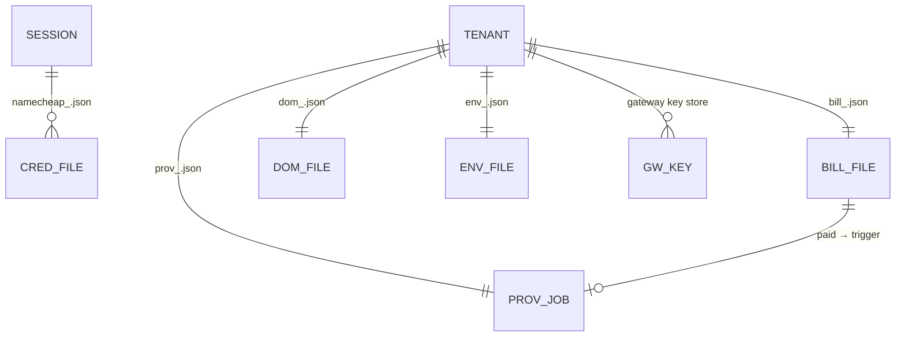
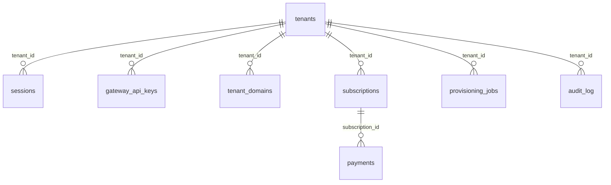

# 05 — Backend Schema — AImulti.inbox (landing-go)

**Data**: 21/10/2026 · **Stato attuale**: file-based per-account su volume `/credentials` (verificato su checkout.go/main.go/provisioning.go/spend.go) · **Target Fase 2**: PostgreSQL 16 self-hosted EU/CH (design completo in docs/database-design.md).

---

## 1. Schema attuale: stato persistito (tutto su `/credentials`, 0600)

| File | Contenuto reale | Scritto da | Letto da |
|---|---|---|---|
| `namecheap_<sha256(sid)[:16]>.json` | credenziali Namecheap per sessione, **AES-256-GCM** (AAD = sid) | `storeCreds` (main.go) | `readCreds`, `ncCall` |
| `bill_<sha256(username)[:16]>.json` | `{status, plan, subscription_id, customer_id, …}` | `handleCheckoutWebhook` (checkout.go) | `planFor`, `handleCheckoutState` |
| `dom_<hash>.json` | `{domains: [...], ts}` — domini gateway toccati dall'account | `addProvisionedDomain` | `provisionedDomains` |
| `env_*.json` | scelta ambiente onboarding (shared/dedicated) | onboarding flow | `nodeTenantCount` (cap 80/nodo) |
| `prov_*.json` | `{plan, instance_type, est_monthly_eur, status: queued\|running\|done\|failed, error}` | `queueProvisioning` (provisioning.go) | `provScanJob`, `monthlyCommittedEUR` (spend.go) |
| gateway key store | chiavi `gwk_…` con scope (`can_write`, `domain`) + ultimo dry_run hash per dominio | `gatewayKeyStore.Create/Revoke` | `Verify`, `handleZoneSet` |

**Sessioni**: in-memory map (`sessionStore` di main.go) — token 32-byte server-issued, CSRF, TTL cred 24h con reap orfani. **Persistono solo su disco i file sopra; le sessioni muoiono a ogni restart** (rischio split-brain alla Fase 2 → Postgres, vedi database-design.md §1).

## 2. Limiti d'integrità già enforced (fail-closed)

1. **Credenziali mai in chiaro**: AES-256-GCM + AAD legato al sid; due sessioni non condividono mai stato (fix S2 Strix)
2. **Subscription solo su paid verificato**: il webhook rifà `GET /payments/{id}` con la nostra chiave prima di scrivere `status=paid` — mai il body Mollie
3. **Cap domini nel write path**: `PATCH api/gateway/domains/{domain}` → 402 se oltre il cap del piano (`planFor`)
4. **Cap nodo**: `nodeTenantCount() >= MAX_TENANTS_PER_NODE` (default 80) → 503 "contact sales" in `handleCheckout`
5. **Budget**: `spendGuard(instanceType)` rifiuta tipi fuori whitelist (CCX assenti) o oltre `MAX_MONTHLY_SPEND_EUR` (default 20); spesa committed = job prov_ queued+running
6. **Zone set**: apply accettato solo se l'hash del set combacia con l'ultimo dry_run della chiave sul dominio (diff preview obbligatorio)

## 3. Target Fase 2: PostgreSQL 16 (riassunto, DDL completo in docs/database-design.md)

Perché serve alla Fase 2 (secondo node + LB): il file-based diventa **split-brain** (due nodi, due set di file) e le sessioni in-memory rompono il login a ogni deploy. Migrazione zero-downtime: `LANDING_DB_DSN` opzionale → dual-read → import script → cutover (database-design.md §4).

## 4. Retention e backup

- File per-account: TTL 24h per gli orfani (`credTTL`, `reapOrphans`); bill/dom/prov restano (stato di fatturazione)
- Audit log: stdout / log del container (non interrogabile → `audit_log` Postgres alla Fase 2)
- Le mailbox NON sono qui: maildir su disco + MySQL/Redis mailcow — backup segue la runbook mailcow esistente (database-design.md §5)
