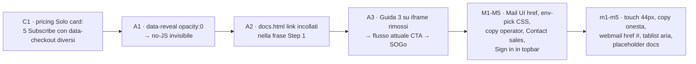
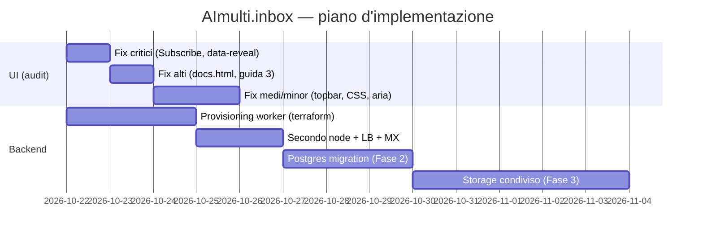

# 06 — Implementation Plan — AImulti.inbox

**Data**: 21/10/2026 · **Branch**: feature/landing-page (non cambiare) · **Fonti**: audit UX `ux_audit_5progetti_2026-10-21.json → projects.multi_ai`, docs/iaas-design.md, docs/database-design.md, codice reale landing/html + landing-go.

---

## 1. Stato: cosa è già fatto (verificato nel codice)

- Landing 11 pagine statiche + 10 asset JS vanilla, CSP-safe (script-src 'self')
- Proxy Go completo: sessioni sicure (fix 4 finding Strix), CSRF, rate limit per IP, Namecheap connector, MCP interno
- Gateway MCP con chiavi scoped + dry-run obbligatorio (zone_get/zone_set/zone_undo)
- Checkout Mollie self-serve: fail-closed 503 senza chiave, webhook verificato server-side, subscription su paid, cap piano enforced (402/503), `MAX_TENANTS_PER_NODE`
- Spend guard fail-closed (`MAX_MONTHLY_SPEND_EUR` default 20, whitelist istanze, CCX bloccati)
- Infra FASE 2 già predisposta in landing/infra (lb.tf Hetzner LB, shared-node.tf, MX 10/20 Namecheap MERGE)
- Suite Go verde (main/checkout/gateway/provisioning/spend)

## 2. Lavoro UI: fix audit UX (priorità audit, critical → minor)

| # | Task | File | Priorità |
|---|---|---|---|
| 1 | Un solo bottone Subscribe per card (refuso di template) | pricing.html | Critical |
| 2 | `[data-reveal]` visibile di default, nascondere solo con JS attivo (classe `.js` su html) | landing.css, app.js | Alto |
| 3 | Rimuovere i 2 link topbar incollati nella frase Step 1 Guida 3 | docs.html | Alto |
| 4 | Riscrivere Guida 3 sul flusso attuale (CTA "Open the webmail client" → login SOGo, niente iframe) | docs.html | Alto |
| 5 | Hardcodare `Mail UI → /home` ovunque (3 fallback incoerenti) | use-cases/docs/pricing + JS | Medio |
| 6 | Spostare CSS `.env-pick` da inline a style.css | onboarding.html, style.css | Medio |
| 7 | Modal login: messaggio per utente, dettaglio operator in log | app.js | Medio |
| 8 | "Contact sales" → mailto o form dedicato (non il wizard) | pricing.html | Medio |
| 9 | Aggiungere Sign in ghost in topbar di use-cases/pricing/docs | 3 pagine | Medio |
| 10 | Touch target ≥ 44px (`.btn` 40px, `.small-btn` 28px), Retry + copy onesta inbox.js, webmail CTA disabled su errore, tablist aria-controls/frecce, placeholder rotto docs.html | CSS + JS + HTML | Minor |

## 3. Lavoro backend: provisioning pipeline (iaas-design.md §4-5)

| Fase | Cosa | Sforzo | File |
|---|---|---|---|
| **1** | Worker esterno che consuma `prov_*.json` queued → `terraform apply` (hcloud) → install mailcow → DNS write → onboarding email. Terraform mai in-process (già in codice) | 2–3 gg | landing/infra/, worker |
| **2** | Secondo shared node + Hetzner LB (già predisposto: lb.tf round_robin, health `/landingpage/api/status:8080`) + MX weight 10/20 (MERGE Namecheap) | 1–2 gg | infra/, nginx |
| **3** | Storage condiviso (NFS → Ceph) + scale orizzontale postfix/dovecot + MySQL replica | 3–5 gg | infra/, runbook |
| **DB** | PostgreSQL 16 alla FASE 2 (il file-based diventa split-brain): DSN opzionale → dual-read → import → cutover | 2–3 gg | database-design.md §4 |

## 4. Ordine di esecuzione proposto

## 5. Verifica per ogni task UI

1. **No-JS**: aprire ogni pagina con JS disattivo — il main (hero, card, CTA) deve essere visibile
2. **Piano giusto**: clic di ogni Subscribe → `POST /api/checkout` con il piano corretto della card (data-checkout coerente col tier mostrato)
3. **Flusso webmail**: Guida 3 di docs.html deve descrivere solo passi che esistono (CTA → /home → login SOGo)
4. **Coerenza topbar**: Mail UI → /home in tutte le pagine; Sign in presente ovunque
5. **A11y**: touch ≥ 44px, tablist con frecce, focus visibile, role=alert sui messaggi
6. **Regressione backend**: `go test ./...` verde dopo ogni tocco a app.js/landing.go condivisi

## 6. Rischî e mitigazioni

- **Refuso template pricing** (critical): un utente può pagare il piano sbagliato → fix prima di tutto, poi verifica con checkout sandbox
- **Nodo pieno durante il lancio**: 503 onesto già implementato → metriche nodo nel monitoring :8791, pre-allarme a 70% cap (iaas-design.md §4)
- **Budget Hetzner**: nessun hard cap nativo → spendGuard fail-closed + limiti Console (iaas-design.md §7); Dedicated sbloccato solo con il primo cliente
- **Split-brain sessioni**: in-memory fino alla Fase 2 → documentare il restart come disconnessione attesa (nota in settings/admin), migrare a Postgres prima del secondo node
